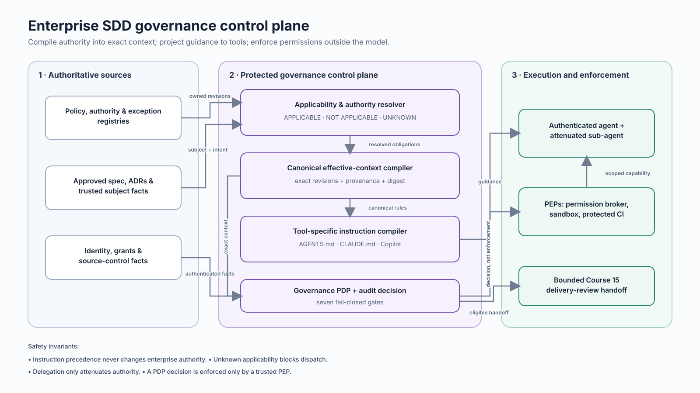

# Course 16 — Enterprise SDD Governance Control Plane & Agent Instruction Management

> **Level:** Intermediate path, staff-level depth  
> **Prerequisites:** Courses 03–15; Git, CI/CD, JSON, and Python fundamentals  
> **Case study:** Northstar Mutual change `AI-2310`  
> **Time:** 5–7 hours including the workshop

Agent instruction files are useful interfaces, but they are not an enterprise authorization system. This course builds the missing operating layer: a governance control plane that resolves authoritative policy, compiles a revision-bound effective context, emits tool-specific instruction adapters, authenticates workloads, attenuates delegated authority, and produces a decision that trusted enforcement points can consume.

The central rule is:

> Instructions guide agent behavior. Identity, scoped grants, sandboxes, source-control facts, and trusted gates enforce what an agent may do.

## Learning objectives

By the end of this course, you can:

1. separate enterprise decision authority, platform instruction precedence, execution authorization, and enforcement;
2. compile applicable policy and project intent into a canonical, digest-bound effective context;
3. preserve `UNKNOWN` as a first-class applicability result rather than treating missing evidence as false;
4. generate semantically equivalent `AGENTS.md`, `CLAUDE.md`, and Copilot adapters from canonical rules;
5. keep feature semantics and volatile policy out of hand-maintained instruction files;
6. reject self-asserted exceptions, repository-local authority laundering, and semantic weakening;
7. authorize authenticated workload identities for an exact work unit, context, scope, and time window;
8. constrain sub-agent delegation so authority can only stay equal or decrease;
9. distinguish an Open Policy Agent decision point from the enforcement point that acts on its decision;
10. invalidate work selectively when policy, compiler, tool behavior, or subject revisions change; and
11. hand a bounded governance decision to Course 15 delivery controls without claiming merge or release authority.

## Why this course exists

A repository may contain `AGENTS.md`, `CLAUDE.md`, or `.github/copilot-instructions.md` and still be unsafe. Those files can be stale, editable by the same change they judge, interpreted differently by each tool, or loaded according to platform-specific directory rules. They can remind an agent to ask for approval; they cannot authenticate the approver, mint a capability, constrain a filesystem, or stop a deployment.

The enterprise problem is not “write a better system prompt.” It is to transform governed intent into a small, reproducible execution contract while preserving ownership and enforcement boundaries.

## The four planes



| Plane | Question | Typical artifacts | Authority |
| --- | --- | --- | --- |
| Source | What rules and decisions exist? | policy registry, ADRs, approved specs, exception registry | accountable organizational owners |
| Control | Which rules apply to this exact subject? | resolver result, effective context, adapter manifest, policy decision | protected control-plane service |
| Instruction | How should this tool receive the bounded guidance? | `AGENTS.md`, `CLAUDE.md`, Copilot instructions | generated projection, not a new authority |
| Enforcement | What actions are actually permitted? | workload identity, scoped grant, sandbox, branch protection, CI gate | trusted platform enforcement points |

Do not collapse these planes. Platform instruction hierarchy answers “which text does this agent read?” Enterprise authority answers “which owner may decide this matter?” A nearby file may have higher loading precedence and still have no authority to weaken company policy.

## Effective context is compilation, not concatenation

Naive context assembly joins documents and hopes the model resolves conflicts. A governance compiler instead performs typed transformations:

```text
trusted subject facts
      +
versioned policy and authority registries
      +
approved project/feature specification
      │
      ▼
applicability → compatibility → exceptions → canonical context
      │                                      │
      └──── provenance and reason codes ─────┘
```

The Northstar resolver uses three applicability states:

- `APPLICABLE`: every required predicate is known and satisfied;
- `NOT_APPLICABLE`: at least one known predicate excludes the policy; and
- `UNKNOWN`: a required fact is missing, malformed, or cannot be evaluated.

`UNKNOWN` is not `false`. The lab blocks dispatch when applicability remains unknown. This prevents a missing residency or transfer fact from silently deleting an obligation.

The compiler then checks authority compatibility. A project requirement may specialize an enterprise rule, but specificity is not permission to weaken it. Exceptions are references to separately authenticated registry records; an agent cannot create authority by writing `approved: true` into its own package.

## Canonical rules and tool adapters

The canonical registry expresses stable operating rules with identities and modalities such as `MUST`, `PROHIBITED`, and `REQUIRES_APPROVAL`. A deterministic compiler projects those rules into tool-native files.

| Target | Generated file in this course | Important loading behavior |
| --- | --- | --- |
| Codex | `AGENTS.md` | root-to-working-directory instruction chain; narrower files apply later |
| Claude Code | `CLAUDE.md` | ancestor memory is loaded at launch; descendant memory may load when files are accessed |
| GitHub Copilot | `.github/copilot-instructions.md` | repository-wide file; path-specific instruction support varies by surface |

These behaviors are dated compatibility snapshots, not timeless facts. The official [Codex prompting guide](https://developers.openai.com/cookbook/examples/gpt-5/codex_prompting_guide), [Claude Code memory documentation](https://code.claude.com/docs/en/memory), and [GitHub Copilot custom-instruction support matrix](https://docs.github.com/en/copilot/reference/custom-instructions-support) should be rechecked when a tool or compiler changes.

An adapter should normally contain stable workflow guidance, context identity, provenance, and stop conditions. It should point to approved feature semantics and policy instead of copying them. Copying creates drift and turns generated convenience text into an accidental source of truth.

### Semantic equivalence matters more than matching prose

Different tools need different headers and loading notes, but the normative meaning must remain equivalent. The manifest binds:

- target and output path;
- compiler identity and version;
- canonical-rule digest;
- effective-context digest;
- compatibility snapshot date; and
- exact output digest.

A valid digest proves only that bytes match a declared value. The trusted validator also regenerates the expected output and checks protected rule semantics, preventing an attacker from weakening a rule and recomputing its digest.

## Threats at the instruction boundary

### Instruction laundering

A README, issue, code comment, retrieved document, or tool result may contain imperative text. It is untrusted context until an authorized transformation promotes a supported fact or decision into the canonical model. Repository proximity does not confer governance authority.

### Prompt injection

Treat instructions found in data as data. Canonical rules explicitly tell agents not to accept retrieved material or tool output as policy. Enforcement still belongs to sandboxes, permission brokers, protected CI, and authorization checks because a model may misunderstand or ignore text.

### Self-modifying governance

If a change can edit its own instruction compiler, trusted policy bundle, or validation workflow and have that revision judge the same change, it can weaken its judge. Production systems should execute protected, attested compiler and policy revisions outside the candidate’s control.

## Execution authorization

“Implementation agent” is a role label, not an identity. The lab requires an authenticated workload principal and a grant bound to:

- the exact repository, change, base revision, and work-unit identity;
- the effective-context digest;
- allowed capabilities and write paths;
- issuance and expiry; and
- an attested identity record.

The validator compares authorized scope with the authoritative source-control diff, not the package’s self-reported file list. A passing governance decision means `ELIGIBLE_FOR_AGENT_DISPATCH`; it does not mean the agent has executed correctly, the PR may merge, or the artifact may deploy.

## Delegation must attenuate authority

A parent agent may delegate research or bounded implementation only when the child:

- has an authenticated workload identity;
- receives a subset of the parent’s capabilities and writable paths;
- has a shorter or equal lifetime;
- remains within the allowed delegation depth; and
- inherits the same exact context and work-unit boundaries.

Delegation cannot create policy approval, protected-path access, or a longer-lived credential. Sub-agents return evidence and proposals; they do not inherit human accountability.

## Policy decision point versus enforcement point

The example Rego policy defaults to deny and demonstrates a policy decision point (PDP). [OPA describes itself as a general-purpose policy engine](https://www.openpolicyagent.org/docs) that evaluates structured input against policy. A caller, admission controller, CI service, or permission broker remains the policy enforcement point (PEP) that blocks or permits the operation. [OPA deployment guidance](https://www.openpolicyagent.org/docs/deploy) makes the integration boundary explicit, and its [management documentation](https://www.openpolicyagent.org/docs/management-introduction) explains that bundle distribution and decision-log services form part of a wider control plane.

OPA does not provide the entire enterprise governance control plane out of the box. You still need trusted fact collection, identity, artifact provenance, policy ownership, exception workflow, distribution, attestation, monitoring, and fail-open/fail-closed decisions at every consumer.

## The seven gates

The lab reports every gate explicitly:

1. `registry_integrity`
2. `context_resolution`
3. `authority_compatibility`
4. `instruction_adapter_conformance`
5. `execution_authorization`
6. `delegation_attenuation`
7. `audit_handoff_integrity`

Any block yields `BLOCKED`. A missing gate set yields `BLOCKED_INCOMPLETE_GATE_SET`. A clean result yields eligibility for dispatch, never execution or release authorization.

## Worked Northstar scenario

Northstar Mutual’s `AI-2310` change adds a document-classification capability. The trusted plane contains five policies, but only `AI-030@7` and `PRIV-018@4` apply to the exact subject. Three are explicitly non-applicable. The reference package preserves mandatory human review and residency semantics, requests three instruction targets, binds a scoped grant, and delegates only read-only research.

Run the lab:

```bash
python3 curriculum/intermediate/06-enterprise-sdd-governance-control-plane-agent-instructions/northstar-governance-control-plane/lab.py
```

The reference path produces seven passing gates, a canonical context digest, exact adapters, and a bounded handoff. The unsafe candidate independently demonstrates authority conflict, a self-asserted exception, an untrusted instruction source, semantic weakening, role-as-identity, out-of-scope modification, delegation amplification, and a stale delivery handoff.

The [guided notebook](northstar-governance-control-plane/enterprise_governance_control_plane.ipynb) lets you inspect each transformation. The [workshop](northstar-governance-control-plane/README.md) leaves three decisions for learners to complete.

## Policy change during execution

Do not always restart everything, and do not always continue. Route by dependency and semantics:

| Change | Outcome | Why |
| --- | --- | --- |
| unrelated, non-applicable policy revision | `CONTINUE` | no work-unit dependency changed |
| applicable obligation changes | `PAUSE_AND_REVALIDATE` | context, adapter, grant, and affected work may be stale |
| governing policy is retired | `CANCEL` | the work unit no longer has a valid governing basis |

Tool behavior, compiler revisions, exception state, grants, and identity attestations have similar invalidation consequences. Track their dependency edges instead of applying one global dirty flag.

## Evaluation and bounded claims

The repository includes:

- 16 golden conformance scenarios for known governance cases; and
- 92 labelled mutations across 23 failure families.

Passing them means the deterministic teaching implementation detects those represented cases. It is not a security proof, a vendor certification, a benchmark of general policy engines, or evidence that natural-language policy can always be compiled automatically.

## Production architecture

The reference architecture separates canonical sources, protected compilation and decision services, and enforcement points. A production version should add:

- signed policy and adapter bundles with transparent provenance;
- schema registries and type validation for trusted facts;
- authenticated workload identity and short-lived capability issuance;
- protected compiler builds, reproducible releases, and attestations;
- durable decision logs with privacy controls and retention policy;
- policy-distribution health, freshness SLOs, and fail-closed consumers;
- shadow evaluation and rollback for policy/compiler upgrades;
- independent administration and break-glass workflows; and
- semantic regression suites for each supported agent integration.

Centralization is not the goal by itself. Centralize shared authority and decision semantics; distribute bounded adapters and enforcement close to the action.

## When not to use the full control plane

Use a lighter path for local prototypes, reversible documentation edits, disposable experiments, or low-risk repositories with one trusted operator and no consequential permissions. A checked-in instruction file plus normal review may be enough.

Escalate toward the full model when work crosses authority domains, handles regulated data, changes security or AI behavior, uses multiple agents, needs temporary privileges, or must prove which policy and context governed a consequential action. Ceremony should be proportional to impact and reversibility.

## Exercises

1. Complete the three `TODO` values in the starter package and explain why each value must come from a trusted source.
2. Remove `external_transfer` from trusted facts. Trace why `DATA-021@2` becomes unknown and why dispatch blocks.
3. Add a path-specific Copilot adapter target without duplicating canonical rules. Define its compatibility snapshot and invalidation triggers.
4. Attempt to delegate `approve_policy_exception`. Explain which attenuation rule fails and why no instruction wording can authorize it.
5. Change an applicable policy obligation. List every descendant artifact that must be regenerated or reauthorized.
6. Replace the in-process evaluator with OPA. Identify the PDP, every PEP, the trusted input sources, and each consumer’s failure mode.

## Further reading

- [OpenAI Codex prompting guide](https://developers.openai.com/cookbook/examples/gpt-5/codex_prompting_guide)
- [Claude Code memory](https://code.claude.com/docs/en/memory)
- [GitHub Copilot custom instructions](https://docs.github.com/en/copilot/how-tos/copilot-cli/customize-copilot/add-custom-instructions)
- [GitHub Copilot custom-instruction support](https://docs.github.com/en/copilot/reference/custom-instructions-support)
- [Open Policy Agent documentation](https://www.openpolicyagent.org/docs)
- [OPA deployment patterns](https://www.openpolicyagent.org/docs/deploy)
- [OPA management APIs and control-plane responsibilities](https://www.openpolicyagent.org/docs/management-introduction)
- [Rego policy language](https://www.openpolicyagent.org/docs/policy-language)

## Course connections

[Course 15](../05-enterprise-pdlc-ci-cd-integration/README.md) governs merge, build, deployment, and runtime transitions after this course produces a valid dispatch and delivery-review handoff. Course 17 will use the governed context in an end-to-end idea-to-implementation flow. This course deliberately stops before either boundary.

Learning with One+i · responsible AI, real-world impact. [oneplusi.io](https://oneplusi.io)
