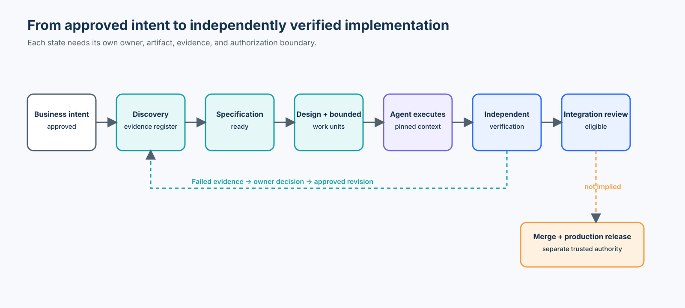
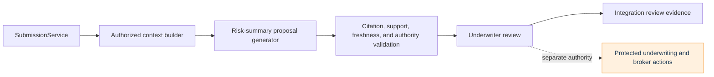

# Course 17 — From Idea to Verified Implementation: The End-to-End Agentic PDLC

> Part IV · Agentic Product Development Lifecycle · Intermediate

Turn an approved business idea into a bounded implementation, independently verified evidence, and an integration-review handoff—without allowing coding agents to invent business, architecture, underwriting, or release decisions.

**Study time:** 5–7 hours · **Format:** chapter, guided notebook, executable vertical slice, failure experiments, workshop, and checkpoint

## Learning outcomes

By the end of this course, you can:

- separate business-intent approval, specification readiness, implementation readiness, integration readiness, and release authorization;
- produce discovery decisions and an evidence register instead of converting notes and assumptions into facts;
- transform approved intent into revisioned behavioral requirements and independently owned acceptance evidence;
- select a minimum-sufficient architecture that preserves trusted application boundaries;
- decompose a change into dependency-aware Agent Work Units (AWUs) with bounded decision rights;
- execute against pinned specification, architecture, repository, context, and permission identities;
- validate citation existence, citation correctness, evidence support, scope, freshness, and forbidden effects;
- route failed verification to implementation repair or accountable specification/design revision;
- compare direct coding with a governed SDD path using explicit populations and outcomes; and
- explain why a verified implementation is not automatically merge- or production-authorized.

## Prerequisites

Complete Courses 01–16, especially:

- [Course 05](../../beginner/05-requirements-engineering-for-agents/README.md) for requirements discovery;
- [Course 07](../../beginner/07-acceptance-criteria-invariants-evidence/README.md) for independent evidence;
- [Course 10](../../beginner/10-specification-to-implementation-plan/README.md) for bounded work units;
- [Course 15](../05-enterprise-pdlc-ci-cd-integration/README.md) for trusted delivery transitions; and
- [Course 16](../06-enterprise-sdd-governance-control-plane-agent-instructions/README.md) for exact agent context and authorization.

Python 3.11+ is sufficient. The default path is credential-free and uses only the standard library.

## Scenario and success boundary

Northstar Insurance change `AI-2410` asks for an underwriting risk-summary capability:

> Generate a concise summary of material risk factors, missing information, and recommended follow-up actions for an underwriting submission.

The business wants reduced review effort. That approval does **not** decide which model to use, whether a new database is needed, whether an agent may alter underwriting state, or whether a broker may be contacted automatically.

The course succeeds when a deterministic feature slice can:

1. build submission-scoped context from authorized evidence;
2. generate a non-authoritative risk-summary proposal;
3. verify every material claim against current cited evidence;
4. block stale context, unsupported claims, injection-shaped content, and protected side effects;
5. consume a trusted human-review receipt for the exact proposal once; and
6. stop at `READY_FOR_INTEGRATION_REVIEW`.

It does not claim production model quality, business impact, legal compliance, merge approval, or deployment authorization.

## 1. The lifecycle is a set of controlled transformations

The weak mental model is:

```text
ticket → agent → code → tests pass → production
```

The useful mental model is:

```text
intent → discovery → specification → design → bounded implementation
       → independent evidence → integration review → trusted delivery
```

Every arrow can introduce an assumption, omit an obligation, widen authority, or bind evidence to the wrong subject. Each state therefore needs an owner, artifact, entry criteria, exit evidence, and invalidation rules.



The feedback route matters as much as the forward route. A failed test may indicate defective code, but it may also reveal an infeasible requirement, an incomplete acceptance criterion, or a stale architecture decision. The implementation agent does not choose which interpretation becomes authoritative.

## 2. Readiness is plural

| State | Question answered | Typical accountable owner | Strongest justified outcome |
| --- | --- | --- | --- |
| Business intent approved | Why invest? | Product or business | Continue discovery |
| Discovery resolved | What facts and unknowns shape the change? | Product, domain, architecture | Draft normative intent |
| Specification ready | What behavior is required? | Requirement owners | Design against approved behavior |
| Implementation ready | What bounded work may execute? | Engineering and architecture | Dispatch pinned work units |
| Verification passed | Does the exact candidate satisfy declared claims? | Independent evidence producers | Request integration review |
| Integration ready | Does the composed candidate remain valid? | Delivery control plane | Request merge authorization |
| Release ready | May this exact artifact enter an environment? | Release authority | Controlled deployment |

A Product Owner approving a ticket establishes business intent. It does not automatically settle data handling, architecture, model access, acceptance criteria, workload permissions, or deployment authority.

## 3. Discovery should produce decisions

Discovery is not complete because meetings happened or a long document exists. It is complete for a bounded scope when consequential questions are either resolved by an accountable source or retained as explicit blockers.

The [AI-2410 discovery record](northstar-risk-summary/specs/AI-2410/discovery.md) distinguishes:

- confirmed repository and platform facts;
- approved business outcomes;
- unknown model-quality claims;
- blocked automatic broker communication; and
- explicit non-goals.

Use an evidence register:

```text
ID            Statement                               State       Authority/evidence
DISC-2410-01  SubmissionService owns state            CONFIRMED   architecture record
DISC-2410-03  gateway supports production population  UNKNOWN     representative eval needed
DISC-2410-04  automatic broker send is allowed        BLOCKED     owner decision needed
```

Repository behavior is evidence of current reality, not proof that the behavior is desired or authorized. Conversely, an approved requirement does not make an incompatible repository disappear; the conflict must be routed.

## 4. Keep outcomes separate from implementation choices

“Reduce underwriter review effort” is an outcome. “Use three agents, a vector database, and provider X” is a proposed design.

Treating outcome language as architecture permission creates hidden decisions. The discovery package should identify:

- the outcome and its owner;
- the capability boundary;
- applicable constraints;
- facts and uncertainties;
- decisions already made; and
- implementation questions still open.

Do not invent a 40% improvement target without a baseline, measurement window, population, accountable owner, and acceptable trade-offs. Course 17 evaluates the engineering control path, not a fabricated business KPI.

## 5. Translate discovery into normative behavior

The executable specification uses five obligations:

- `REQ-RISK-001`: use only authorized evidence and approved context;
- `REQ-RISK-002`: every material claim cites current supporting evidence;
- `REQ-RISK-003`: insufficient evidence remains unresolved;
- `REQ-RISK-004`: summaries do not decide or mutate underwriting outcomes; and
- `SEC-RISK-001`: model-facing execution cannot mutate underwriting state or contact brokers.

The [requirements](northstar-risk-summary/specs/AI-2410/requirements.yaml) are JSON-formatted YAML so the standard-library lab can parse the same artifact deterministically. Their meaning is framework-neutral: they can be represented in Spec Kit, OpenSpec, or a repository-native process without transferring ownership to that framework.

## 6. Acceptance criteria are evidence designs

A citation requirement has at least three distinct checks:

1. **Presence:** a source reference exists.
2. **Correctness:** the reference identifies a current, authorized source.
3. **Support:** the source supports the specific claim.

A model can satisfy the first while failing the other two. The [acceptance package](northstar-risk-summary/specs/AI-2410/acceptance.yaml) therefore includes happy, missing-source, unsupported-claim, protected-action, and stale-revision cases.

Examples do not exhaust a requirement. Add negative, boundary, failure, stale-state, replay, injection, and wrong-subject cases where the risk justifies them.

## 7. Use capability-specific readiness

Do not reduce the whole feature to one “approved” boolean.

| Capability | Course state | Reason |
| --- | --- | --- |
| Authorized evidence selection | READY | Trusted application filter exists |
| Risk-summary proposal | READY_FOR_BOUNDED_IMPLEMENTATION | Behavior and scope are explicit |
| Citation and support validation | READY | Independent criteria exist |
| Human review handoff | READY | Exact-subject receipt contract exists |
| Automatic broker communication | BLOCKED | Protected authority unresolved |
| Underwriting-state mutation | OUT_OF_SCOPE | Existing service retains ownership |

Partial readiness allows safe progress without laundering authority for unrelated capabilities.

## 8. Design the minimum sufficient architecture

The selected pattern is proposal → deterministic validation → human review.



The [design record](northstar-risk-summary/specs/AI-2410/design.md) compares direct coding, a fully autonomous agent, deterministic rules, and proposal-and-review. The selected design reuses current ownership boundaries and minimizes consequential model authority.

## 9. Frameworks are process harnesses, not authorities

Current GitHub Spec Kit documents an SDD sequence that can include constitution, specify, clarify, plan, checklist, tasks, analyze, implement, and converge. Current OpenSpec documentation describes proposal, delta specs, design, tasks, apply, and archive. Both can help structure transformations; neither inherently owns Northstar policy, architecture approval, workload grants, or release authority.

A practical mapping is:

| Enterprise state | Spec Kit expression | OpenSpec expression | Organization-owned extension |
| --- | --- | --- | --- |
| Approved intent | idea assessment handoff or intake | proposal motivation | accountable intent record |
| Required behavior | spec and clarification | delta specs | inherited policy and domain authority |
| Design | plan | design | ADR approval and repository facts |
| Work | tasks | tasks | bounded AWUs and grants |
| Verification | analyze/converge plus tests | validate plus evidence | independent evidence registry |
| Delivery | outside feature artifacts | archive/integration boundary | merge, build, deployment, runtime controls |

Use the smallest process that preserves the required decisions and evidence. A typo does not need this entire course workflow.

### Technology selection landscape

| Approach | Strengths | Limitations | Best fit | Enterprise extension still needed |
| --- | --- | --- | --- | --- |
| Repository-native Markdown, ADRs, tests, and CI | Portable, transparent, minimal tooling | Teams must design lifecycle consistency themselves | Small or mature teams with strong conventions | Authority registry, evidence identity, protected delivery |
| GitHub Spec Kit | Rich specification-to-convergence workflow and broad agent integration | Framework artifacts do not establish organizational authority | Feature development needing structured refinement | Policy resolution, grants, independent evidence, release controls |
| OpenSpec | Clear current-truth versus proposed-delta model | Archive semantics alone do not prove conformance or authorization | Brownfield and concurrent change | Conflict ownership, exact evidence, integration and release gates |
| Ticket-to-code automation | Low ceremony and fast local feedback | Silent assumptions, weak traceability, self-confirming tests | Tiny, reversible, well-understood changes | Risk triage and an escalation route |
| Custom enterprise orchestrator | Can integrate identity, policy, evidence, and delivery | Highest platform cost and lock-in risk | Repeated consequential changes across many teams | Ongoing governance, compatibility testing, and portability strategy |

Choose by change risk, repository maturity, artifact semantics, current-truth model, portability, observability, and extension cost—not by framework popularity.

### Established practice, emerging practice, and open problems

- **Established:** version-controlled requirements, ADRs, code review, independent tests, protected branches, least privilege, provenance, rollback, and accountable release decisions.
- **Emerging:** agent-oriented process harnesses, compiled instruction adapters, exact context manifests, workflow convergence, and policy-aware work-unit dispatch.
- **Research frontier:** reliable semantic conformance between prose and code, scalable independent evaluation of agent-produced changes, impact analysis across evolving specifications, and calibrated automation of ambiguous discovery.
- **Open problems:** measuring specification quality without proxy gaming, preserving human decision bandwidth at scale, detecting authority laundering through generated artifacts, and proving that production populations match evaluation populations.

Do not present emerging automation as a substitute for established software and organizational controls.

## 10. Decompose work after contracts stabilize

The [AWU graph](northstar-risk-summary/specs/AI-2410/work-units.yaml) establishes:

```text
AWU-RISK-CONTRACT
        │
        ├── AWU-RISK-GENERATION
        └── AWU-RISK-VALIDATION
                  │
                  └── AWU-RISK-INTEGRATION
```

Parallel execution is useful only when contracts are stable, write ownership is exclusive, evidence obligations are independent, and review capacity exists. More agents can increase integration work and privileged surface even when wall-clock implementation becomes shorter.

Each AWU names requirements, dependencies, writable paths, allowed local decisions, proposals requiring escalation, forbidden decisions, stop conditions, and required evidence.

The [working PR sequence](northstar-risk-summary/specs/AI-2410/pr-sequence.yaml) turns that graph into three reviewable increments: contracts and intent, bounded implementation, then integration evidence. Each PR rebases on its merged predecessor, has explicit exclusions and checks, and preserves the release boundary. The accompanying [traceability map](northstar-risk-summary/specs/AI-2410/traceability.json) connects every requirement to design, AWUs, code, independent tests, and evidence.

## 11. Execute against pinned context

The trusted application binds:

- specification revision `3`;
- architecture revision `ADR-RISK-008@2`;
- repository base `northstar-training-base-2410`;
- submission identity `SUB-2410-001`;
- exact document revisions;
- readable evidence; and
- capabilities limited to evidence read and proposal creation.

The model does not choose a convenient revision. If the specification or evidence changes, the old proposal becomes stale even when its prose still looks plausible.

## 12. A real vertical slice

The [Northstar lab](northstar-risk-summary/README.md) is application code, not only a policy simulator:

- `app/contracts.py` defines typed trust-boundary objects;
- `app/context_builder.py` selects authorized subject-scoped evidence;
- `app/generator.py` provides a deterministic proposal generator and an unsafe baseline;
- `app/validator.py` checks exact context, scope, citation, support, freshness, and effects;
- `app/review.py` consumes exact-subject review receipts once;
- `lab.py` runs the workflow, experiments, baseline comparison, conformance suite, and mutation evaluation; and
- `evidence/manifest.json` records independent fixture evidence and limitations.

Run it from the repository root:

```bash
python3 curriculum/intermediate/07-idea-discovery-spec-design-implementation/northstar-risk-summary/lab.py
```

The result is `READY_FOR_INTEGRATION_REVIEW`, not “production ready.”

## 13. Direct coding versus governed delivery

The direct baseline accepts every typed proposal without checking its citations, evidence support, context revision, or attempted actions. The governed path evaluates seven labelled cases.

Metrics report a population, numerator, denominator, and bounded claim. The expected fixture result is 7/7 correct governed decisions and 0 independently validated baseline decisions. This is not a benchmark of any model or framework.

Complex process is not automatically better. The comparison asks what risk the added transformations control and what cost they introduce. For a small reversible change with no protected decision, a lightweight path may be more appropriate.

## 14. Completion is not verification

“Implementation complete; 12 tests passed” is an execution report. It does not establish that:

- evidence sources were authorized;
- citations support their claims;
- the evaluation population is representative;
- protected actions remained impossible;
- the reviewed proposal matches the exact candidate; or
- release authority exists.

Independent checks should be designed from requirements and risk, not solely authored by the implementation agent.

## 15. Convergence must preserve intent authority

When verification fails:

```text
failure
  ├─ implementation defect → repair code and rerun affected evidence
  ├─ evidence defect       → repair the evaluator or evidence production
  ├─ feasibility issue     → owner decides whether intent changes
  └─ requirement conflict  → authority resolves and revisions propagate
```

Do not relax a requirement merely because the current implementation cannot satisfy it. Approved semantic change produces a new revision and invalidates affected design, work, context, tests, and review receipts.

## 16. Failure modes and anti-patterns

| Failure | Why it is unsafe | Control |
| --- | --- | --- |
| Approved ticket treated as implementation-ready | Missing decisions become agent assumptions | Separate readiness states |
| Repository behavior treated as desired intent | Legacy defects become requirements | Evidence register and conflict routing |
| Planner-generated design treated as approval | Proposal launders architecture authority | ADR owner and explicit design state |
| Every work unit assigned to a new agent | Coordination tax and authority surface grow | Dependency and review-capacity analysis |
| Agent-authored tests treated as independent proof | Self-confirming evidence loop | Independent acceptance and negative tests |
| Citation presence treated as grounding | Wrong or unsupported sources pass | Existence, authorization, revision, and support checks |
| Retrieved instructions obeyed | Untrusted content changes control behavior | Typed context and narrow tools |
| Passing implementation triggers deployment | Verification collapses into release | Separate merge and release receipts |

## 17. Evaluation and observability

The lab records context digest, proposal digest, validation findings, evidence IDs, terminal state, and release boundary. It avoids private reasoning.

The default evaluation contains:

- seven required experiments;
- twelve end-to-end golden scenarios; and
- thirty-nine labelled mutation cases across twelve failure families.

These counts describe fixture coverage. They do not certify production security, model accuracy, or organizational compliance.

For production, measure at least grounded-claim rate, unsupported-claim rate, citation correctness, valid work blocked, forbidden effects attempted and realized, review latency, rework, cost per successful compliant summary, and outcome metrics on an approved population.

## 18. Production upgrade path

| Training mechanism | Production requirement |
| --- | --- |
| Static JSON evidence | Authenticated source and evidence registries |
| In-memory receipt store | Durable atomic single-use consumption |
| Deterministic generator | Approved gateway, versioned prompts/models, and representative evaluation |
| Exact risk-term support | Domain-reviewed semantic support evaluator with uncertainty |
| Fixture submission | Tenant/subject authorization before evidence retrieval |
| Local context digest | Signed provenance and secure freshness source |
| One process | Durable orchestration, retries, cancellation, concurrency, and recovery |
| Integration-ready state | Protected merge, build provenance, deployment receipt, rollout, and runtime evidence |

## 19. When not to use the full workflow

Use a smaller path when the change is low-risk, local, reversible, well-understood, independently testable, and free of protected decisions. Examples include a typo, a narrow documentation link, or a mechanically safe dependency metadata update.

Use the fuller path when ambiguity, probabilistic behavior, sensitive data, consequential side effects, cross-team contracts, architecture change, high rollback cost, or regulatory obligations make silent assumptions expensive.

## 20. Exercises

1. **Implementation:** add an `INSUFFICIENT_EVIDENCE` result without weakening citation support rules.
2. **Diagnosis:** mutate an authorized document after context compilation and explain every invalidated descendant.
3. **Security:** add a tool-shaped instruction to evidence and prove it cannot add a capability.
4. **Architecture:** compare one-agent and two-agent execution for the AWU graph; include review capacity and integration cost.
5. **Governance:** route a request for automatic broker communication without blocking summary proposal work.
6. **Evaluation:** add four labelled boundary cases and report both correct blocks and valid work blocked.
7. **Convergence:** simulate a requirement revision and identify which evidence may be retained.

## Checkpoint

1. What does Product Owner ticket approval establish?
2. Which artifact owns a conflict between repository reality and approved behavior?
3. How should partial readiness handle blocked broker communication?
4. What happens when a plan proposes replacing the approved model gateway?
5. What state does an implementation agent’s passing test report establish?

Complete the focused checkpoint in the [Learning Hub](https://mahsa-teimourikia.github.io/spec-driven-development/hub/) and the cumulative [knowledge check](https://mahsa-teimourikia.github.io/spec-driven-development/quiz/).

## References

- [GitHub Spec Kit — official repository and current process overview](https://github.com/github/spec-kit)
- [GitHub Spec Kit — Agentic SDD reference](https://github.com/github/spec-kit/blob/main/docs/reference/agentic-sdd.md)
- [GitHub Spec Kit — existing-project guidance](https://github.com/github/spec-kit/blob/main/docs/guides/existing-projects.md)
- [OpenSpec — official overview](https://github.com/Fission-AI/OpenSpec/blob/main/docs/overview.md)
- [OpenSpec — spec-driven schema](https://github.com/Fission-AI/OpenSpec/blob/main/docs-lab/reference/schemas/spec-driven/index.md)
- [GitHub Docs — required status checks](https://docs.github.com/en/repositories/configuring-branches-and-merges-in-your-repository/managing-protected-branches/about-protected-branches)
- [NIST AI Risk Management Framework](https://www.nist.gov/itl/ai-risk-management-framework)
- [NIST AI RMF Generative AI Profile](https://nvlpubs.nist.gov/nistpubs/ai/NIST.AI.600-1.pdf)

Preview Course 18: Brownfield development in the [course plan](../../../COURSE_PLAN.md).
