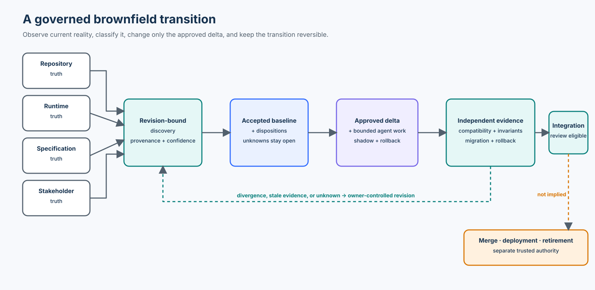

# Course 18 — Brownfield Development with Agentic Coding Agents

> Part IV · Agentic Product Development Lifecycle · Intermediate/Advanced

Safely modify mature enterprise software by discovering current reality, classifying behavior, specifying a semantic delta, preserving compatibility, and proving a reversible transition—without allowing a coding agent to decide which legacy behavior deserves to survive.

**Study time:** 5–7 hours · **Format:** chapter, guided notebook, executable migration slice, failure experiments, workshop, checkpoint, and cumulative quiz

## Learning outcomes

By the end of this course, you can:

- perform repository-grounded discovery with explicit provenance, confidence, and revision identity;
- distinguish observed, intended, approved, and target behavior;
- use characterization tests without turning every legacy behavior into a requirement;
- classify current behavior as `PRESERVE`, `MODIFY`, `RETIRE`, `DEFECT`, or `UNKNOWN`;
- construct semantic change deltas and dependency-aware impact graphs;
- assess API, data, event, behavioral, authorization, operational, and performance compatibility;
- select strangler fig, branch-by-abstraction, expand-and-contract, feature-flag, and shadow strategies;
- design idempotent migrations, selective regression, controlled rollout, and tested rollback;
- invalidate stale discovery and evidence after repository, specification, or consumer changes; and
- produce an evidence-backed handoff that stops before merge, deployment, or retirement authority.

## Prerequisites

Complete Courses 10, 14, 16, and 17. Course 10 supplies bounded work units, Course 14 supplies current-truth and semantic-delta concepts, Course 16 supplies trusted context and authorization, and Course 17 supplies the end-to-end readiness and evidence boundaries.

Python 3.11+ is sufficient. The default path is credential-free and uses only the standard library.

## Scenario and success boundary

Northstar Mutual already operates an Underwriter Assistant. Change `AI-2410` asks the team to add evidence-grounded AI risk-summary proposals.

The dangerous interpretation is “replace the old risk engine with AI.” The approved interpretation is narrower:

> Add a non-authoritative summary proposal alongside existing deterministic risk classification and human underwriting review.

The course succeeds when the reference package:

1. binds discovery to an exact repository revision;
2. preserves deterministic risk classification, high-risk review, v1 semantics, and legacy reads;
3. adds a grounded proposal path behind an abstraction;
4. stores proposals idempotently without granting authority;
5. blocks stale context, unknown retirement, missed consumers, semantic breaks, flag-as-authorization, and unavailable rollback;
6. selects impacted regression tests while retaining protected invariants; and
7. stops at `READY_FOR_INTEGRATION_REVIEW`.

It does not prove production model quality, migration safety at enterprise scale, legal compliance, business outcomes, merge approval, deployment approval, or permission to retire the legacy path.

## 1. Brownfield work is a transition problem

Greenfield work can begin with intended behavior:

```text
intent → specification → design → implementation
```

Brownfield work begins with a system that already has users, data, consumers, workarounds, defects, and operational history:

```text
existing system + approved change → governed transition → target behavior
```

Use the conceptual equation:

\[
T = B + \Delta - D
\]

- `T`: target behavior;
- `B`: accepted baseline;
- `Δ`: approved additions and modifications; and
- `D`: explicitly authorized retirements.

This is not code arithmetic. The team must first decide which observed behaviors belong in `B`, which defects must not be legitimized, and which removals have a named owner.



## 2. Four kinds of truth can disagree

| Source | Useful evidence | What it cannot establish alone |
| --- | --- | --- |
| Repository truth | What the checked-out code appears to implement | Intent, active use, or authorization |
| Runtime truth | What the deployed system actually does | Whether behavior is approved |
| Specification truth | What approved artifacts require | Current conformance or operational feasibility |
| Stakeholder truth | What users and owners expect | Consistency, approval, or implementation reality |

If the specification says conflicts require human review, code auto-resolves them, telemetry shows auto-resolution, and the Product Owner expects review, the agent has found a discrepancy—not permission to choose the winner.

Record:

- the conflicting claims;
- source identity and revision;
- verification status;
- affected capability and population;
- accountable owner; and
- whether work can continue safely around the discrepancy.

## 3. Begin with a discovery manifest, not edits

A useful discovery loop is:

```text
approved change intent
  → static and dynamic discovery
  → behavior inventory
  → disposition and impact analysis
  → target specification and transition plan
  ↺ repeat when consequential unknowns appear
```

The [discovery record](northstar-underwriter-modernization/specs/AI-2410/discovery.md) and [executable manifest](northstar-underwriter-modernization/fixtures/discovery-manifest.json) include:

- exact commit identity;
- inspected paths and entry points;
- consumers and persistent effects;
- relevant specifications and decisions;
- provenance for each finding;
- calibrated confidence; and
- open questions.

An agent explanation is a discovery proposal. It becomes trusted input only after the application validates its provenance and freshness. The reference validator also compares the manifest with a protected union of static references, API contracts, registered owners, and runtime observations. A consumer omitted from the proposal remains visible in that independent evidence and blocks integration.

### Static and dynamic evidence are complementary

| Static discovery | Dynamic discovery |
| --- | --- |
| imports and call graphs | runtime traces |
| API and event schemas | observed request/response behavior |
| migrations and queries | production query patterns |
| tests and configuration references | active configuration and traffic |
| ownership metadata | incidents and operational procedures |

Static search may find a callable function. Telemetry may show no recent calls. Neither result alone proves the function is safe to remove: seasonal traffic, external consumers, compliance jobs, and rollback procedures may be absent from the sample.

## 4. Characterization is observation, not approval

A characterization test records what happens now:

```python
assert classify_risk(49) == "LOW"
assert classify_risk(50) == "MEDIUM"
assert classify_risk(79) == "MEDIUM"
assert classify_risk(80) == "HIGH"
```

An acceptance test records what approved target behavior requires. Mature suites need both, but with different provenance.

| Characterization | Acceptance |
| --- | --- |
| Derived from observed implementation/runtime | Derived from approved requirements |
| Detects unexpected changes | Establishes target conformance |
| May encode workarounds or defects | Must not silently legitimize defects |
| Protects transition compatibility | Protects intended outcomes and invariants |

The [baseline behavior register](northstar-underwriter-modernization/specs/AI-2410/baseline-behaviors.yaml) demonstrates all five dispositions:

- `PRESERVE`: approved behavior remains;
- `MODIFY`: approved change alters it;
- `RETIRE`: a named owner authorizes removal;
- `DEFECT`: observation contradicts approved behavior; and
- `UNKNOWN`: evidence or authority is incomplete.

`UNKNOWN` blocks retirement. `DEFECT` does not automatically permit a fix inside an unrelated feature.

## 5. Specify a semantic delta

The [semantic delta](northstar-underwriter-modernization/specs/AI-2410/semantic-delta.yaml) keeps `REQ-RISK-010` and `REQ-RISK-011` intact while adding proposal-specific obligations.

```text
PRESERVE deterministic category
PRESERVE HIGH → human review
PRESERVE API v1 structure and meaning
ADD evidence-grounded summary proposal
ADD proposal-is-not-authority invariant
ADD idempotent migration requirement
RETIRE nothing
```

This prevents a common coding-agent error: treating “modernize risk processing with AI” as permission to replace an approved decision system.

Current truth and target truth must remain separately inspectable until the change is integrated. Archiving a change artifact later does not prove the implementation conforms.

## 6. Impact is semantic, not file-shaped

Changing one provider can affect:

```text
RiskSummaryProvider
  ├─ SubmissionAPIv1
  ├─ UnderwriterAssistant
  ├─ NightlyRiskBatch
  ├─ LegacyPortal
  ├─ RiskReporting
  ├─ persisted summaries
  └─ observability and rollback
```

The [impact analysis](northstar-underwriter-modernization/specs/AI-2410/impact-analysis.json) gives every confirmed consumer an impact disposition and evidence obligation. A source-code diff cannot reveal all of these relationships.

For each edge ask:

- Is structure changing?
- Is meaning changing?
- Can old and new versions coexist?
- Does data need expansion, migration, or backfill?
- Are asynchronous consumers version-tolerant?
- Do identity, privilege, or audit semantics change?
- What happens to latency, capacity, dashboards, and incident response?
- Is rollback technically and operationally possible?

## 7. Compatibility has multiple dimensions

| Dimension | Example break |
| --- | --- |
| API | remove a field used by an old client |
| Data | reinterpret a stored value without migration |
| Event | publish a shape or ordering consumers cannot handle |
| Behavioral | keep the schema but change `review_required` from true to false |
| Authorization | give the proposal service decision privileges |
| Operational | remove a signal used by an incident procedure |
| Performance | exceed an approved latency or capacity target |

A schema-valid response can still be unsafe:

```json
{"submission_id":"SUB-1","risk_category":"HIGH","review_required":false}
```

The fields are unchanged; the underwriting meaning is not. Consumer-driven contract tests can expose integration assumptions, but the approved specification still defines business correctness. Consumers can agree on the same wrong behavior.

## 8. Choose a migration pattern deliberately

### Strangler Fig

Incrementally route bounded capabilities to a new implementation while the existing path remains operational. Choose it when a capability boundary can be intercepted and migrated independently.

### Branch by Abstraction

Move consumers behind a stable interface, run old and new implementations, and switch incrementally. Course 18 uses `LegacySummaryProvider` and `AISummaryProvider`; both return non-authoritative proposals.

### Expand and Contract

1. **Expand:** add compatible structures.
2. **Migrate:** move data and consumers with discrepancy evidence.
3. **Contract:** remove old structures only after consumer retirement, data verification, rollback planning, and approval.

Course 18 adds `summary_proposal` while preserving `submission.risk_summary`. The contract phase is a separate authorized change.

### Feature flags and shadow execution

A flag chooses exposure. It does not grant resource access, a write capability, or underwriting authority. The credential-free lab resolves a synthetic trusted grant bound to principal, submission, operation, and policy revision before provider selection, then resolves it again immediately before persistence.

```text
flag evaluation → capability enabled?
authorization   → may this actor act on this subject?
execution       → perform the bounded operation
verification    → record independent evidence
```

Shadow execution runs both providers on the same submission and compares their actual outputs with an approved oracle. Differences are classified as expected, acceptable, unexpected, or unresolved. Unexpected and unresolved divergence route to review; a difference alone does not make the new or old result correct.

## 9. Idempotency belongs at the state boundary

“Check, then insert” is vulnerable to concurrent retries. The reference `ProposalStore` uses a unique key on `(submission_id, source_revision)`, compares a canonical payload digest inside the transaction, returns `ALREADY_APPLIED` only for a semantically identical retry, and returns `IDEMPOTENCY_CONFLICT` for a different payload under the same key.

Migration invariants are:

- `MIG-INV-001`: submission identity is preserved;
- `MIG-INV-002`: approved legacy summaries remain readable;
- `MIG-INV-003`: AI proposals never become authoritative; and
- `MIG-INV-004`: retrying the same source revision creates no duplicate.

An agent-generated migration script is not evidence that these hold. Execute tests against the authoritative state transition and exercise retry, concurrency, interruption, and restart behavior.

## 10. Selective regression needs a safety floor

The [regression plan](northstar-underwriter-modernization/specs/AI-2410/regression-plan.yaml) combines:

```text
changed component tests
+ affected consumer contracts
+ affected integrations
+ protected invariants
+ periodic broad regression
```

Selective testing optimizes feedback. It never removes mandatory security, authority, data-integrity, or safety gates. A static dependency graph can be incomplete, so protected tests are selected independently of discovered edges. The planner returns both selected tests and unmapped consumers; a critical consumer without a verification path blocks integration.

Useful evidence includes both selection quality and execution outcomes:

- impacted consumers with a disposition / confirmed impacted consumers;
- protected invariants selected / required protected invariants;
- selected tests executed / selected tests;
- failures by changed component, consumer, integration, and invariant;
- broader-suite escape rate over a named window; and
- investigation rate for unknown edges.

Do not claim impact recall when the complete population is unknown.

## 11. Staleness and concurrency invalidate confidence

Discovery, plans, approvals, and test results bind exact subjects:

- repository commit;
- specification revision;
- dependency and contract revisions;
- migration state;
- dataset and environment identity; and
- code candidate digest.

If another change merges into a shared contract, rebase and re-run affected discovery, impact analysis, and evidence. “The agent already finished” is not a freshness exception.

For concurrent brownfield changes:

1. declare current-truth and target-truth revisions;
2. identify overlapping requirements, components, consumers, and state;
3. define ordering or conflict ownership;
4. invalidate approvals when their subject changes; and
5. verify the integrated result, not only isolated branches.

## 12. Rollout is an evidence-producing experiment

The [rollout and rollback plan](northstar-underwriter-modernization/specs/AI-2410/rollout-and-rollback.yaml) moves through expand, shadow, limited exposure, and an explicitly separate contract decision.

Each phase needs:

- entry criteria;
- eligible population;
- exposure and authorization controls;
- monitoring and comparison metrics;
- stop conditions;
- rollback trigger and owner;
- rollback procedure and rehearsal evidence; and
- evidence expiry rules.

Rollback means returning to a known-good compatible state. The lab executes the sequence: observe legacy, enable the proposal path, persist a non-authoritative proposal, disable the path, and verify that the legacy provider, legacy v1 response, legacy reads, and authoritative state are intact. Disabling a UI flag alone is not a complete rollback.

## 13. Run the vertical slice

The [Northstar workshop](northstar-underwriter-modernization/README.md) contains application code, artifacts, fixtures, tests, failure injections, and a starter exercise.

```bash
python3 curriculum/intermediate/08-brownfield-development-with-agentic-coding-agents/northstar-underwriter-modernization/lab.py
```

The lab runs:

- 12 golden conformance cases;
- 24 labelled artifact mutations whose findings are derived from changed behavior, not labels;
- 10 focused failure experiments;
- a direct-agent versus governed-path comparison;
- semantic v1 compatibility checks;
- protected selective regression;
- transactional retry identity and conflict detection;
- measured shadow comparison and an executed rollback rehearsal; and
- rollout and retirement authority boundaries.

The guided notebook imports this reusable code; it does not duplicate a toy version of the lab.

## 14. Failure experiments to perform

| Experiment | Expected response |
| --- | --- |
| Repository revision changes after discovery | Invalidate and rediscover affected scope |
| External consumer is missing from the impact graph | Block integration readiness |
| Characterization test captures an approved defect candidate | Keep observation; do not make it target truth |
| v1 fields remain but HIGH no longer requires review | Block semantic incompatibility |
| Migration job retries | One proposal record; no duplicate effect |
| Feature flag is enabled without capability grant | Block before provider execution |
| Shadow result diverges | Route to review; neither path wins automatically |
| Protected invariant is absent from selected tests | Block regression plan |
| Rollback has never been tested | Block rollout readiness |
| Agent marks AI output authoritative | Block authority escalation |

## 15. Compare against a realistic baseline

The [direct-agent candidate](northstar-underwriter-modernization/candidate/direct-agent-replacement.json) sees old code, replaces the risk engine, runs its own tests, and reports success. It does not bind a commit, map all consumers, distinguish classification from summarization, preserve v1 meaning, or design rollback.

The governed path is more expensive. Its value is bounded to the risks it exposes in the labelled fixture. The comparison does not prove that every brownfield change needs this much process or that a particular agent or framework performs better in production.

## 16. When not to use the full workflow

Use a lighter path when the change is:

- small and locally reversible;
- isolated behind a well-understood contract;
- free of data migration and protected decisions;
- covered by trustworthy tests and ownership; and
- unlikely to affect unknown consumers.

Escalate toward the full workflow as uncertainty, blast radius, persistence, authority, irreversibility, or external consumption grows. Keep the non-negotiables: exact scope, current repository context, relevant tests, review, and rollback appropriate to the risk.

## 17. Production upgrades

The teaching lab intentionally omits enterprise infrastructure. A production implementation should replace fixtures with:

- authenticated repository, artifact, service-catalog, and telemetry sources;
- signed or otherwise verifiable discovery and evidence manifests;
- a real contract registry and ownership service;
- database-specific migration, locking, backup, restore, and reconciliation procedures;
- workload identity and policy enforcement independent of feature flags;
- representative shadow populations and privacy controls;
- durable observability, incident response, and rollback automation;
- rulesets, required checks, and accountable code-owner review; and
- post-deployment conformance and outcome monitoring with named windows.

## 18. Staff-level review checklist

- [ ] Is discovery bound to an exact current repository revision?
- [ ] Does every consequential finding have provenance and calibrated confidence?
- [ ] Are observed, approved, target, and unknown behaviors separated?
- [ ] Does every retirement have explicit authority and consumer evidence?
- [ ] Does the delta preserve deterministic classification and human authority?
- [ ] Are semantic compatibility and structural compatibility both tested?
- [ ] Does the impact graph include code, consumers, data, events, operations, and authorization?
- [ ] Are protected invariants selected independently of the dependency graph?
- [ ] Is idempotency enforced by the authoritative state boundary?
- [ ] Are flags, authorization, execution, and verification separate?
- [ ] Are shadow divergences reviewed rather than auto-resolved?
- [ ] Is rollback compatible, rehearsed, observable, and owned?
- [ ] Does evidence bind the exact integrated candidate and expire on change?
- [ ] Does the handoff stop before merge, deployment, and legacy retirement authority?

## Checkpoint

A new implementation returns the same v1 fields and passes its own tests, but changes `review_required` to `false` for HIGH risk. What should happen?

1. Accept it because the schema is backward compatible.
2. Block integration because the semantic contract and protected invariant changed.
3. Let the feature flag authorize the new meaning.

**Answer:** 2. Structural compatibility does not preserve meaning. The governed path ties HIGH-risk review to an approved requirement and a protected invariant.

## References

- [Martin Fowler — Strangler Fig](https://martinfowler.com/bliki/StranglerFigApplication.html)
- [Martin Fowler — Branch by Abstraction](https://martinfowler.com/bliki/BranchByAbstraction.html)
- [Pact documentation — contract testing and consumer-driven contracts](https://docs.pact.io/)
- [PostgreSQL documentation — transaction isolation and `ON CONFLICT`](https://www.postgresql.org/docs/current/transaction-iso.html)
- [OpenFeature documentation](https://openfeature.dev/docs/)
- [GitHub documentation — CODEOWNERS](https://docs.github.com/en/repositories/managing-your-repositorys-settings-and-features/customizing-your-repository/about-code-owners)
- [GitHub documentation — ruleset rules](https://docs.github.com/en/repositories/configuring-branches-and-merges-in-your-repository/managing-rulesets/available-rules-for-rulesets)
- [Course 14 — OpenSpec for enterprise change-driven SDD](../04-openspec-enterprise-change-driven-sdd/README.md)
- [Course 17 — End-to-End Agentic PDLC](../07-idea-discovery-spec-design-implementation/README.md)

## Next course

Course 19 narrows the operating model for bug fixes and small changes: choosing proportional ceremony without giving up diagnosis, evidence, or authority boundaries.
