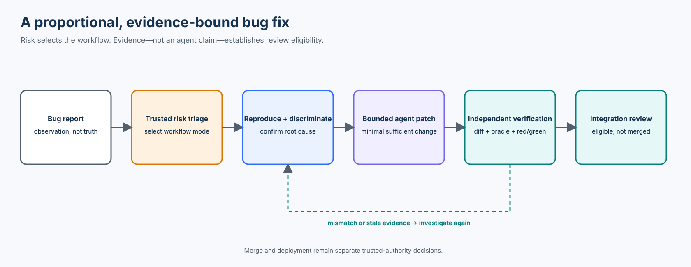

# Course 19 — Bug Fixes and Small Changes with Agentic Coding Agents

> Part IV · Agentic Product Development Lifecycle · Intermediate/Advanced

Apply specification-driven development proportionally to maintenance work. The goal is not to turn every typo into a ceremony. It is to give coding agents enough bounded authority and independently produced evidence to make a small change safely—without letting “small diff” become a synonym for “low risk.”

**Study time:** 4–6 hours · **Format:** chapter, guided notebook, executable bug-fix slice, ten failure experiments, workshop, checkpoint, and cumulative quiz

## Learning outcomes

By the end of this course, you can:

- distinguish a bug report, an observation, a hypothesis, a requirement, and an approved fix;
- select a lightweight, structured, or governed workflow from consequence and uncertainty rather than line count;
- write a minimal bug-fix contract with explicit scope, non-goals, evidence, and stop conditions;
- reproduce a defect on a named baseline before accepting a patch;
- separate symptom, proposed cause, root-cause hypothesis, and discriminating experiment;
- protect the acceptance oracle from being weakened by the same agent that changes production code;
- validate actual changed paths, rename endpoints, and change purpose against a trusted work unit;
- bind red-green evidence to the defect, oracle, baseline revision, candidate revision, and trusted producer;
- recognize stale specifications, conflicting requirements, scope expansion, and root-cause mismatch; and
- stop at integration-review readiness without treating successful checks as merge or deployment authority.

## Prerequisites

Complete Courses 05–10, 16, and 18. Those courses establish executable requirements, acceptance evidence, quality review, bounded work units, trusted instruction context, and brownfield discovery.

Python 3.11+ is sufficient. The default path is credential-free and uses only the standard library.

## Scenario and success boundary

Northstar Mutual receives `BUG-2415`: a risk score of exactly `80` is reported as `MEDIUM`, although approved requirement `REQ-RISK-010@3` says high risk begins at `80`. The code uses `score > 80` instead of `score >= 80`.

That one-character patch looks trivial. It still affects an underwriting review decision. A safe workflow must prove:

1. the baseline really fails at `80`;
2. the current approved requirement really means `HIGH_STARTS_AT_80`;
3. the comparison operator is the cause on the production path;
4. the patch changes only the authorized code and regression test;
5. adjacent boundaries remain correct;
6. the agent did not weaken the oracle;
7. evidence belongs to the exact baseline, candidate, and acceptance contract; and
8. the result is ready for review—not silently authorized for release.

The exercise does not establish production rollout safety, portfolio-level risk outcomes, regulatory approval, merge approval, or deployment approval.



## 1. Small is a property of scope, not risk

Line count is a weak risk measure. A one-line change can alter authentication, money movement, data retention, a safety limit, or human-review routing. A large mechanical rename can be behaviorally low risk.

Use six dimensions:

| Dimension | Question |
| --- | --- |
| Consequence | What happens if this change is wrong? |
| Authority | Does it change who or what may decide or act? |
| Scope | How many components, consumers, or records can change? |
| Reversibility | Can the change be detected and rolled back safely? |
| Uncertainty | How confident are we about current behavior and root cause? |
| Exposure | How many users, transactions, or protected subjects encounter it? |

The executable lab uses those inputs to choose a workflow. The exact scoring formula is illustrative; an enterprise should version its own policy and make mandatory floors explicit.

### Three proportional modes

| Mode | Appropriate when | Minimum evidence |
| --- | --- | --- |
| `LIGHTWEIGHT` | low consequence, known cause, narrow scope, easy reversal | issue, bounded diff, targeted check, reviewer |
| `STRUCTURED` | meaningful behavior, moderate uncertainty, or multiple evidence obligations | bug contract, reproduction, hypothesis test, work unit, regression, diff verification |
| `GOVERNED` | protected authority, high consequence/exposure, difficult reversal, or mandated policy | approved requirements, named owners, protected controls, independent evidence, explicit gates |

The agent may request a higher mode. It must not downgrade a mode selected by trusted policy.

## 2. A bug report is an observation

“Score 80 should be HIGH” may be correct, but a report alone does not establish normative truth. It can combine several different claims:

```text
observed: API returned MEDIUM for score 80
expected by reporter: API should return HIGH
approved requirement: REQ-RISK-010@3 says HIGH begins at 80
proposed cause: the comparison operator excludes the boundary
proposed fix: replace > with >=
```

Only the first item is a direct observation. The approved requirement establishes the expected behavior. The cause and fix remain hypotheses until tested.

### Minimum useful report

- stable defect ID;
- exact environment and code revision;
- smallest reproducible input;
- actual output;
- expected output and its authority;
- impact and frequency;
- evidence references; and
- known privacy or security restrictions.

Do not copy secrets, production personal data, access tokens, or unrestricted logs into agent context. Use minimized fixtures and controlled evidence access.

## 3. Separate symptom from cause

A symptom is what a user or control can observe. A root cause is the condition that explains the symptom and predicts what changes when corrected.

For `BUG-2415`, plausible hypotheses include:

| Hypothesis | Prediction | Discriminating experiment |
| --- | --- | --- |
| Comparison operator | buggy classifier returns `MEDIUM`; corrected classifier returns `HIGH` at 80 | call both functions with 80 |
| Normalization | production path changes 80 to 79 | inspect normalized score through API path |
| Cache | a unique submission avoids the defect | repeat with new identity |
| Serialization | in-memory value is HIGH but response becomes MEDIUM | compare pre/post serialization |

A test is discriminating when competing explanations predict different results. “Run all tests” may detect a failure, but it does not necessarily tell the agent which explanation survived.

### Root-cause mismatch

Suppose a unit test proves the operator fix, but the API normalizer subtracts one before classification. The unit test goes green while the production path still returns `MEDIUM`. That is not merely incomplete testing; it is evidence that the chosen causal model does not explain the exercised system.

Stop and revise the hypothesis. Do not widen the patch opportunistically.

## 4. The minimal bug-fix contract

A small change does not need a feature-sized specification. It does need a compact executable contract:

```yaml
bug_id: BUG-2415
baseline_revision: baseline:bug-2415
specification_revision: 3
observed: score 80 returns MEDIUM
required: REQ-RISK-010@3 says score 80 returns HIGH
writable_paths:
  - app/risk_engine.py
  - tests/test_regression.py
non_goals:
  - redesign taxonomy
  - refactor decision service
stop_if:
  - requirement conflict
  - defect cannot be reproduced
  - protected path must change
  - production path indicates another cause
```

This contract tells an agent what it may change, what it must preserve, what evidence is required, and when it must stop.

### Requirement precedence still applies

If one approved artifact says HIGH begins at `80` and another says it begins at `85`, the agent has discovered a normative conflict. It must not choose the newest timestamp, the nearest file, or the easiest implementation unless the organization's precedence rules explicitly grant that authority.

## 5. Red before green

Valid repair evidence is a transition:

```text
same regression identity
same protected expectation
baseline revision → FAIL
candidate revision → PASS
```

A passing test after the patch is insufficient. The test could be irrelevant, newly weakened, accidentally skipped, or already passing before the change.

The Course 19 evidence receipt binds:

- `bug_id`;
- baseline revision;
- candidate revision;
- acceptance-contract digest;
- before observation;
- after observation; and
- trusted producer identity.

This is an educational deterministic receipt, not a cryptographic attestation system. Production systems should add signed provenance, isolated runners, artifact retention, and identity-backed workload authorization.

## 6. Protect the oracle

An agent can make a suite green in two ways:

1. correct production behavior; or
2. change what the test accepts.

The second path is often a test-oracle attack, even when accidental.

For protected behavior:

- keep normative expectations in an owner-controlled artifact;
- compare the candidate oracle with the trusted oracle by content digest;
- require separate approval to change the oracle;
- treat changed or deleted tests as semantic changes; and
- run independent checks outside the agent's writable set.

Test names and comments are not authoritative. An agent can label a test `test_score_80_is_high` while asserting `MEDIUM`. The evaluator must inspect executable expectation content.

## 7. Minimal sufficient patch

“Minimal” does not mean the fewest characters. A sufficient repair normally includes:

- the causal production change;
- the focused regression test;
- any required evidence metadata; and
- no unrelated cleanup.

The work unit authorizes purposes as well as paths. If `app/risk_engine.py` is writable for `correct_boundary_condition`, that does not make an architecture refactor authorized inside the same file.

### Validate the actual diff

Candidate manifests are proposals. The trusted gate must derive changed paths from the repository diff.

For each diff entry, examine:

- additions, modifications, and deletions;
- both old and new paths for renames;
- normalized repository-relative paths;
- protected-path intersections;
- generated artifacts and lock files; and
- whether the change purpose matches the work unit.

The lab uses exact paths for clarity and rejects absolute paths, parent traversal, dot components, and backslashes. A production implementation should also harden symlink resolution, submodules, case-folding differences, sparse checkouts, pathspec semantics, and rename/copy detection.

## 8. Keep the PR coherent

A bug-fix PR should tell one evidence story:

```text
observation → approved expectation → reproduced failure
→ confirmed cause → bounded patch → protected regression
→ actual diff verification → integration-review package
```

Avoid mixing:

- speculative refactors;
- dependency upgrades unrelated to the cause;
- format churn;
- new features;
- policy changes disguised as fixes; or
- test rewrites that obscure the red-green transition.

If another necessary change is discovered, stop and create a separately authorized work unit or ask the owner to widen the current boundary.

## 9. Review evidence, not confidence language

An agent may say “simple fix,” “low risk,” or “all tests pass.” Those statements are not evidence.

A reviewer should be able to answer:

1. Which approved requirement defines correct behavior?
2. Did the same focused regression fail before and pass after?
3. Which experiment distinguished the proposed root cause from alternatives?
4. Does the production path behave correctly?
5. Did adjacent boundaries and invariants remain stable?
6. Did the actual diff remain inside the write set and purpose?
7. Was the acceptance oracle unchanged?
8. Are evidence, code, and specification revisions aligned?
9. Which authority can merge and deploy?

## 10. Worked example: BUG-2415

The initial implementation is:

```python
def classify_risk_buggy(score: int) -> str:
    if score > 80:
        return "HIGH"
    if score >= 50:
        return "MEDIUM"
    return "LOW"
```

The approved correction is:

```python
def classify_risk_fixed(score: int) -> str:
    if score >= 80:
        return "HIGH"
    if score >= 50:
        return "MEDIUM"
    return "LOW"
```

The protected boundaries are `0`, `49`, `50`, `79`, `80`, `81`, and `100`. This set covers both sides of each approved transition and the domain endpoints. It does not prove every property of a future risk model, but it is adequate for this deterministic classifier.

The production-path check calls `risk_response`, not only the classifier. This exposes an upstream `off_by_one_normalizer` mutation that unit-only evidence would miss.

## 11. Ten executable failure experiments

The lab does not teach safety using static “bad example” prose alone. It mutates real candidate artifacts and checks the resulting behavior.

| Experiment | Trusted signal |
| --- | --- |
| Original defect | baseline score 80 produces `MEDIUM` |
| Minimal valid fix | `PASS` |
| Adjacent boundary changed | `SURROUNDING_BEHAVIOR_REGRESSION` |
| Test expectation weakened | `TEST_ORACLE_CHANGED` |
| Extra file added | `SCOPE_EXPANSION` |
| Unit fix misses production path | `ROOT_CAUSE_MISMATCH` |
| Old requirement revision used | `STALE_SPECIFICATION` |
| Authorization code changed | `PROTECTED_PATH_CHANGE` |
| Requirement meaning conflicts | `NORMATIVE_CONFLICT` |
| Old evidence replayed | `STALE_EVIDENCE` |

Mutation labels exist only for the test harness. The evaluator never trusts them; it derives findings from content, behavior, revision identity, and actual diff entries.

## 12. Evaluation design

Useful process metrics separate speed from safety:

- reproduction rate before implementation;
- root-cause confirmation rate;
- first-pass scope conformance;
- protected-oracle change rate;
- escaped-defect rate by workflow tier;
- false-block and missed-block rate for policy gates;
- evidence freshness at review time;
- review rework caused by missing evidence; and
- lead time by risk tier.

Do not claim that proportional SDD improves delivery speed until a representative comparison supports it. This lab makes a narrower claim: across twelve curated cases, the naive baseline accepts all twelve, while the governed evaluator classifies all twelve as expected. That demonstrates the controls' behavior on this fixture set—not production benefit or general superiority.

### Evaluate the evaluator

Course 19 includes:

- 12 conformance cases for stable, named expectations;
- 30 evaluation cases, including combined failures;
- 10 narrative experiments mapped to executable evidence; and
- a direct-agent baseline for comparison.

Production evaluations should include representative historical bugs, adversarial changes, ambiguous reports, false positives, rename and symlink cases, platform path differences, flaky tests, partial outages, and human-review disagreement.

## 13. When not to use the full process

Use a lightweight path when all of the following hold:

- consequence and exposure are low;
- behavior is non-authoritative;
- the cause is known and locally reproducible;
- the diff is narrow and easily reversible;
- no protected contract changes;
- there is no unresolved requirement conflict; and
- a targeted check provides adequate evidence.

Examples may include a spelling correction in non-normative prose, a broken internal link, or deterministic formatting cleanup.

Escalate when any of these appear:

- security, privacy, identity, money, safety, or compliance effects;
- data migration or deletion;
- public API or event semantics;
- model or prompt behavior with uncertain evaluation coverage;
- difficult rollback;
- shared infrastructure;
- unknown consumers;
- conflicting requirements; or
- repeated failed attempts that undermine the original causal model.

The correct response to uncertainty is not always a larger specification. Sometimes it is a smaller discovery task with no implementation authority.

## 14. Enterprise implementation pattern

```text
issue system
  → trusted risk policy
  → minimal bug contract
  → isolated reproduction
  → bounded agent worktree
  → independent CI evidence
  → code-owner review
  → protected branch gate
  → separately authorized deployment
```

Git supplies revision identity and machine-readable diffs. CODEOWNERS can request review from accountable teams, while protected branches can require reviews and status checks. These controls must be configured deliberately: a repository file alone does not prove enforcement, and review assignment does not replace requirement authority.

NIST's Secure Software Development Framework provides a broader vocabulary for integrating secure practices into each lifecycle implementation. This course specializes that idea for small agentic changes; it does not claim that this exercise alone satisfies the SSDF.

## 15. Technology choices

The lab intentionally uses the Python standard library:

- `dataclasses` make evidence subjects explicit;
- `hashlib` binds canonical JSON artifacts;
- `pathlib.PurePosixPath` supports repository-path checks;
- `unittest` keeps the course dependency-free; and
- JSON keeps fixtures inspectable by people and tools.

In production, teams may replace these components with policy engines, signed attestations, CI provenance, schema validators, repository APIs, and centralized evidence stores. Preserve the semantics when replacing the mechanism.

## 16. Lab

From the repository root:

```bash
python3 curriculum/intermediate/09-bug-fixes-and-small-changes-with-agentic-coding-agents/northstar-bugfix/lab.py
python3 -m unittest tests/test_course_19.py
```

The runner makes no network calls. A successful report contains:

```text
state: READY_FOR_INTEGRATION_REVIEW
conformance: 12/12
evaluation: 30/30
experiments: 10/10
```

Then open `northstar-bugfix/bugfix_small_changes.ipynb` and work through each mutation. Complete the five decisions in `workshop/starter/bugfix-package.json` before comparing it with the reference package.

## 17. Workshop prompts

1. Rewrite an ambiguous bug report as observed, expected, authority, impact, and unknowns.
2. Design two competing root-cause hypotheses and one discriminating experiment.
3. Choose the workflow mode for each change request in `fixtures/change-requests.json`.
4. Identify which files belong in the writable set and which are protected.
5. Explain why a green result without a baseline failure is inconclusive.
6. Add a rename case and verify both paths are evaluated.
7. Propose a production-grade evidence attestation without giving the coding agent signing authority.
8. Define the condition that would force this change from structured to governed.

## 18. Checkpoint

You are ready to continue when you can defend each statement:

- I can explain why risk is not diff size.
- I can turn a report into a minimal contract without inventing normative intent.
- I can prove a defect existed before the patch.
- I can design an experiment that discriminates competing causes.
- I can keep the test oracle outside the agent's ordinary write authority.
- I can validate actual diff content and rename endpoints.
- I can bind evidence to exact subjects and revisions.
- I know when to stop and request an owner decision.
- I do not confuse review eligibility with release authority.

## State of practice

**Established:** regression tests, protected branches, required reviews, repository diffs, code ownership, least privilege, and revision-bound build artifacts are mature engineering practices.

**Emerging:** organization-wide proportional SDD policies, agent-specific evidence receipts, automated semantic-diff review, and standardized authority boundaries across agent frameworks are still developing.

**Open questions:** measuring when governance overhead is proportionate, evaluating causal reasoning at enterprise scale, detecting semantically weakened tests across languages, and preserving evidence identity across multi-repository changes require further operational evidence.

## References

- [Git diff documentation](https://git-scm.com/docs/git-diff) — machine-readable comparison and diff semantics.
- [Git user manual: pathspecs](https://git-scm.com/docs/user-manual) — repository path matching concepts.
- [GitHub: About code owners](https://docs.github.com/en/repositories/managing-your-repositorys-settings-and-features/customizing-your-repository/about-code-owners) — review ownership and repository configuration.
- [GitHub: About protected branches](https://docs.github.com/en/repositories/configuring-branches-and-merges-in-your-repository/managing-protected-branches/about-protected-branches) — required reviews and status checks.
- [NIST SP 800-218, Secure Software Development Framework](https://csrc.nist.gov/pubs/sp/800/218/final) — secure development practices integrated into lifecycle implementations.
- [Google SRE Workbook: Postmortem culture](https://sre.google/workbook/postmortem-culture/) — learning-oriented incident analysis.
- [Google SRE Workbook: Postmortem analysis](https://sre.google/workbook/postmortem-analysis/) — structured analysis of incident data.

## Next

Course 20 extends these ideas to changes that cross repository boundaries, where evidence identity, ownership, and release coordination must remain coherent across several independently versioned systems.
