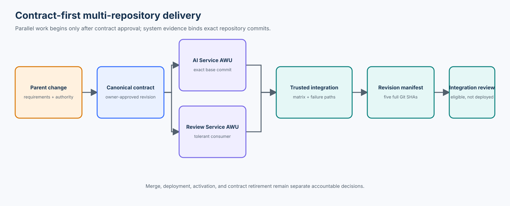

# Course 20 — Multi-Repository Spec-Driven Development with AI Coding Agents

> Enterprise Spec-Driven Development · Part IV: Agentic PDLC · Course 20 of 38

**Theme:** Deliver one business change across independently owned repositories without letting local agents reinterpret shared requirements, invent contracts, or confuse green repository CI with system readiness.

**Level:** Advanced intermediate / staff AI scientist  
**Prerequisites:** Courses 10, 11, and 14–19  
**Case study:** Northstar Mutual — AI-assisted broker document review  
**Practical stack:** Python standard library, Git, OpenSpec-style change artifacts, JSON Schema, OpenAPI, GitHub Actions

## Course thesis

You should be able to explain, implement, evaluate, and productionize a parent/child, contract-first change across independently versioned repositories—using pinned Git revisions, bounded repository work units, compatibility matrices, and trusted system-level evidence without treating local CI as release authority.

## Learning outcomes

By the end, you will be able to:

1. design a parent/child specification model spanning multiple repositories;
2. distinguish enterprise, domain, system, repository, and work-unit requirements;
3. establish accountable ownership for shared API, event, and data contracts;
4. discover consumers and build requirement, contract, implementation, and deployment graphs;
5. coordinate contract-first implementation and backward-compatible migrations;
6. bind repository-local Agent Work Units to exact Git commits and bounded authority;
7. test structural, semantic, behavioral, security, operational, and version compatibility;
8. plan for mixed-version operation, partial deployment, rollback, and reconciliation;
9. assemble system evidence for an exact set of repository revisions; and
10. stop at integration-review eligibility without self-authorizing merge, deployment, activation, or retirement.

## Start here

From the repository root:

```bash
python3 curriculum/intermediate/10-multi-repository-spec-driven-development-with-ai-coding-agents/northstar-multirepo/lab.py
python3 -m unittest tests/test_course_20.py -v
```

Then work through the guided [notebook](northstar-multirepo/multirepo_sdd.ipynb) and complete the [AI-2500 workshop](northstar-multirepo/README.md).



The diagram is a dependency and assurance view, not an exact runtime call sequence.

---

# Part I — Understanding multi-repository systems

## 1. The Northstar scenario

Northstar wants an AI-assisted broker document review workflow. A broker uploads a document; the system extracts it, proposes a classification, routes ambiguity for human review, and exposes authoritative requirement state to an underwriter.

The capability spans five fictional training repositories:

| Repository | Responsibility | Accountable team |
| --- | --- | --- |
| `northstar/document-service` | ingestion, extraction, document identity | Document Platform |
| `northstar/ai-service` | non-authoritative classification proposals | Applied AI |
| `northstar/review-service` | human-review workflow and deduplication | Underwriting Operations Engineering |
| `northstar/underwriting-api` | authoritative requirement state | Core Underwriting |
| `northstar/underwriter-ui` | proposal and decision presentation | Product Engineering |

The repositories deploy independently. A coding agent in one checkout cannot infer the current contracts, revisions, ownership, or rollout state of all the others.

## 2. Why independent repository development fails

One agent may produce:

```json
{"classification":"LOSS_HISTORY","requirement_id":"REQ-45","confidence":0.96}
```

while a consumer expects:

```json
{"document_type":"LOSS_HISTORY","candidate_requirement_ids":["REQ-45"],"review_required":true}
```

Both implementations can be internally consistent and locally green. Together they are incompatible. This is a contract-ownership and system-assurance failure, not merely a coding error.

## 3. Five specification levels

```text
ENTERPRISE     policy, privacy, security, AI governance
     ↓
DOMAIN         underwriting meaning and review obligations
     ↓
SYSTEM         AI-2500 capability behavior and shared contracts
     ↓
REPOSITORY     local contribution to the capability
     ↓
WORK UNIT      bounded executable change for one repository revision
```

| Level | Defines | Must not redefine |
| --- | --- | --- |
| Enterprise | organization-wide controls | N/A |
| Domain | underwriting meaning | enterprise policy |
| System | end-to-end behavior and shared interfaces | domain or enterprise authority |
| Repository | local implementation obligations | shared system meaning |
| Agent Work Unit | authorized paths, purposes, evidence, and stops | any approved normative decision |

The hierarchy carries stable identity, revision, owner, provenance, applicability, and authority. Copying prose into five repositories creates five drift surfaces; it does not preserve governance.

---

# Part II — Parent and child specifications

## 4. The parent change

The canonical [AI-2500 parent change](northstar-multirepo/parent-change/AI-2500.json) establishes four system obligations:

- supported documents receive classification proposals;
- ambiguous classifications require authorized human review;
- AI proposals cannot independently satisfy underwriting requirements; and
- proposals preserve document, evidence, and model provenance.

These requirements belong to the system capability. Repository agents consume them; they do not own their meaning.

## 5. Child changes

Each repository has a [child specification](northstar-multirepo/parent-change/children/) that declares:

- the exact parent ID and revision;
- the repository and accountable contribution;
- requirements implemented;
- contracts consumed and produced; and
- decisions explicitly prohibited.

For example, `AI-2500-AI` produces `CONTRACT-CLASSIFICATION-001@2` but may not alter underwriting authority or human-review policy.

## 6. Semantic drift

If the parent says ambiguity requires review while an AI Service child introduces a confidence-based bypass, the correct result is:

```text
PARENT_CHILD_SEMANTIC_CONFLICT
parent: REQ-DOC-2500-02@2
child: AI-2500-AI
reason: child introduces a review bypass not authorized by the parent
```

An LLM may surface a possible contradiction. Consequential resolution remains an accountable owner decision grounded in explicit artifacts.

## 7. Canonical ownership without a monorepo

Viable patterns include a central specification repository, a dedicated contract repository, producer-owned contracts with consumer verification, and a federated registry. Large enterprises often benefit from a federated model with canonical identities and discoverable ownership.

Canonical does not mean “one giant repository.” It means one accountable source for a particular decision at a particular revision.

---

# Part III — Shared contract engineering

## 8. Contracts are integration boundaries

Contracts cover more than payload fields:

- REST and HTTP interfaces;
- messages and events;
- shared data schemas;
- tool or MCP interfaces;
- authentication and authorization expectations;
- errors, timeouts, retries, and idempotency; and
- supported producer/consumer version combinations.

Course 20 includes [JSON Schema revisions 1 and 2](northstar-multirepo/contracts/) plus an illustrative OpenAPI description. Revision 2 adds required evidence and model provenance.

## 9. Structural validity is not behavioral correctness

A JSON Schema can prove that `review_required` is a boolean. It cannot prove that an ambiguous classification sets it to `true`, that the evidence belongs to the same tenant, or that a reviewer is authorized.

| Layer | Question |
| --- | --- |
| Structural | Are fields, types, cardinality, and unknown-property rules valid? |
| Semantic | Does each value mean what the contract owner approved? |
| Behavioral | Are state transitions and failure paths correct? |
| Security | Are tenant, subject, identity, and scope enforced? |
| Operational | Are timeout, retry, deduplication, and reconciliation safe? |
| Versioning | Can every temporary producer/consumer pair coexist? |

## 10. Contract-first delivery

```text
contract proposal
      ↓
impact analysis
      ↓
contract-owner review and approved revision
      ↓
producer implementation ↔ consumer implementation
      ↓
compatibility evidence
      ↓
exact-revision system integration
```

Parallel implementation begins after contract approval, not after two agents independently guess the same interface.

## 11. Contract change proposals

When an AI Service agent discovers a missing provenance field, it proposes a change. It does not directly edit the canonical contract and assume consumers will adapt.

```text
gap discovered → CONTRACT_CHANGE_PROPOSAL → impact analysis → owner review
→ approved @2 → affected work units invalidated → replan and revalidate
```

The repository includes an [OpenSpec-style change package](northstar-multirepo/openspec/changes/AI-2500/) so learners can connect this coordination model to Course 14. It is deliberately checked in and credential-free; the course does not require a live OpenSpec installation.

---

# Part IV — Cross-repository dependency planning

## 12. One graph is insufficient

| Graph | Represents | Example |
| --- | --- | --- |
| Requirement | behavioral and policy dependencies | human review constrains classification |
| Contract | producers, consumers, and owners | AI Service produces ClassificationProposal |
| Implementation | work prerequisites | contract approval precedes client work |
| Deployment | safe runtime rollout order | Review Service v2 precedes AI Service v2 |

Implementation order is not deployment order. A producer may be implemented first against an approved contract while still being deployed after a tolerant consumer.

## 13. The change dependency graph

The executable [change graph](northstar-multirepo/parent-change/dependency-graph.json) makes contract approval a prerequisite for repository work and makes all five child changes prerequisites for integration.

A deterministic topological sort rejects cycles, unknown nodes, and missing dependencies. A graph is planning evidence; it is not permission to dispatch an agent.

## 14. Impact analysis

For a proposed contract revision, impact analysis should report:

- direct producers and consumers;
- transitive consumers, batch jobs, analytics, and external integrations;
- version ranges and deployment ownership;
- affected work units and evidence obligations;
- hidden or uncertain consumers; and
- whether retirement remains blocked.

“No traffic yesterday” does not prove that no relevant consumer exists.

---

# Part V — Mixed-version compatibility

## 15. Mixed versions are normal

Independent deployment creates temporary combinations. New code working with new code is insufficient.

The lab executes this matrix:

| AI Service | Review Service | Result | Meaning |
| --- | --- | --- | --- |
| v1 | v1 | compatible | existing approved behavior |
| v1 | v2 | compatible | new consumer accepts old payloads |
| v2 | v1 | incompatible | old consumer cannot process revision 2 |
| v2 | v2 | compatible | new pair is verified |

These are deterministic teaching-fixture results, not production observations.

## 16. Consumer-first rollout

Because `AI v2 / Review v1` is incompatible, the safe plan is:

1. deploy Review Service v2;
2. verify that it accepts AI Service v1;
3. deploy AI Service v2 with new behavior disabled;
4. verify v2-to-v2 integration;
5. enable bounded traffic; and
6. monitor compatibility, review routing, duplicates, and failures.

Deployment and activation are different transitions. A deployed capability may remain disabled until its evidence and approval conditions are satisfied.

## 17. Expand, migrate, contract

- **Expand:** introduce the new contract and tolerant consumers.
- **Migrate:** deploy compatible producers and consumers, then enable bounded traffic.
- **Contract:** retire the old revision only after consumer inventory and runtime evidence support it.

Rollback compatibility is a required property of the expand phase. If Review v2 rejects AI v1, restoring the old producer will not recover the system.

---

# Part VI — Coordinating agents across repositories

## 18. One agent per repository is not automatically safe

Parallel agents do not answer who owns the contract, who approves architecture, how dependency revisions are pinned, or what happens when one agent discovers a missing requirement. Unbounded parallelism can reduce local coding time while increasing coordination tax and integration debt.

## 19. Parent change control plane

The parent control plane manages canonical revision references, dependency state, work-unit readiness, repository revisions, evidence status, and typed stops. It may use AI for discovery and proposals, but trusted application logic owns authoritative transitions.

```text
agent → proposes, analyzes, implements within an AWU
trusted control plane → validates, authorizes, pins, executes checks, records state
accountable humans/services → approve contracts, architecture, merge, deployment, activation
```

## 20. Repository-local Agent Work Units

The [Course 20 work units](northstar-multirepo/parent-change/work-units.json) bind:

- parent and child changes;
- exact repository baseline commit;
- requirements and contract revision;
- writable paths and purposes;
- decisions the agent may make, may propose, and may not make; and
- stop conditions.

A work-unit document is not a runtime permission. The execution platform must authenticate the workload, issue a subset of authorized capabilities, enforce paths and tools, and revoke access when the lease ends.

## 21. Stale work invalidation

A new parent revision, contract revision, repository base commit, or protected architecture decision invalidates affected work units. The coordinator pauses and replans rather than silently rebasing semantic assumptions.

## 22. Course 21 boundary

Course 20 coordinates one parent change and repository-local work units. Course 21 will deepen parallel-agent delivery, leases, locks, dispatch, cross-repository handoffs, and convergence. This course does not imply that more agents are always better.

---

# Part VII — Integration, rollout, and recovery

## 23. Local success is not system success

Five green repository pipelines prove five sets of local properties. They do not prove compatible contracts, tenant isolation, cross-service authorization, event ordering, idempotency, or end-to-end behavior.

The unsafe baseline in the lab accepts all 16 conformance cases because it trusts local CI. The governed evaluator correctly classifies all 16 using actual Git revisions and system evidence.

## 24. The integration manifest

An [integration manifest](northstar-multirepo/integration/integration-manifest.template.json) names the change, contract revision, five full Git commits, and required evidence. A report that says “integration passed” without naming its exact component revisions is not replay-resistant system evidence.

Branch names and tags are movable. Use immutable full commit identities for evidence subjects.

## 25. System scenarios

The trusted runner executes 11 scenarios:

| Scenario | Required result |
| --- | --- |
| supported document | classification proposal created |
| unsupported document | review or abstention path |
| ambiguous mapping | authorized human review required |
| duplicate event | no duplicate authoritative action |
| missing provenance | proposal rejected |
| cross-tenant reference | access denied |
| Review Service unavailable | safe fallback; no automatic satisfaction |
| old producer / new consumer | compatible behavior |
| new producer / old consumer | deployment prevented |
| stale approval | protected action blocked |
| authority ownership | only Underwriting API owns authoritative state |

Negative cases are first-class evidence, not optional hardening.

## 26. Recovery is a system workflow

If an incompatibility appears after deploying both services:

```text
disable new AI behavior
→ stop incompatible messages
→ drain or quarantine pending work
→ restore a known-good producer
→ verify consumer compatibility
→ reconcile in-flight operations
→ confirm system invariants
```

Rolling back a binary is insufficient when schemas, events, or durable state have changed.

## 27. Do not assume distributed atomicity

If AI Service writes to Review Service and Underwriting API independently, one call can succeed while the other fails. Use an explicit consistency design—such as a transactional outbox, durable workflow state, idempotency key, reconciliation process, or human intervention—based on the business invariant.

For AI-2500, AI Service creates proposals only. Underwriting API remains the sole owner of authoritative requirement-state transitions.

---

# Part VIII — Practical labs

## 28. Lab architecture

The [Northstar multi-repository fixture](northstar-multirepo/) includes five repository templates, each with source, tests, a child-spec reference, and configuration. Every lab run:

1. creates five isolated local Git repositories;
2. commits approved baseline content;
3. applies and commits candidate content independently;
4. runs repository-local tests;
5. derives actual changed paths and full commit IDs from Git;
6. executes mixed-version and system scenarios; and
7. evaluates the candidate package against protected artifacts.

The temporary repositories are deleted after evidence is collected. Their deterministic commit IDs remain stable for the same content and metadata.

## 29. Lab A — Contract-first implementation

The revision-1 contract lacks required evidence and model provenance. Trace the owner-approved revision-2 contract into the AI and Review child specs, inspect their real Git diffs, and verify that work-unit paths contain the observed changes.

Expected result: contract approval precedes parallel producer and consumer work; agents cannot directly approve or mutate the canonical contract.

## 30. Lab B — Mixed-version rollout

Run all four producer/consumer combinations. Derive the compatibility matrix from behavior, select a consumer-first rollout, and prove the rollback pair before enabling traffic.

Expected result: `AI v2 / Review v1` is blocked; `AI v1 / Review v2` remains compatible.

## 31. Lab C — System evidence and recovery

Inject cross-tenant leakage, missing provenance enforcement, duplicate effects, stale approval acceptance, review-dependency failure, and dual-write authority. Observe that local tests may remain green while system verification blocks.

Expected result: evidence binds the exact five commits and contract revision; merge and deployment remain unauthorized.

## 32. Workshop

Complete six decisions in the [starter package](northstar-multirepo/workshop/starter/), run the lab, then compare with the [reference integration package](northstar-multirepo/reference/integration-package.json). The reference is a review handoff, not a deployment receipt.

---

# Part IX — Evaluation and productionization

## 33. What the evaluation measures

| Measure | Numerator | Denominator | Claim |
| --- | ---: | ---: | --- |
| conformance decisions | 16 exact matches | 16 labelled cases | named control behavior |
| mutation decisions | 40 exact matches | 40 labelled cases | labelled fixture coverage |
| integration scenarios | 11 passed | 11 defined scenarios | one deterministic revision set |
| compatibility classification | 4 classified | 4 declared combinations | fixture producer/consumer behavior |

The metrics do not measure general coding-agent accuracy, production reliability, or the completeness of an enterprise consumer inventory.

## 34. Production upgrades

Before using this model in production, add:

- authenticated repository, workload, tenant, contract-owner, and approver identities;
- signed or provenance-attested builds and evidence;
- a durable contract and dependency registry;
- protected branches, CODEOWNERS, and independently enforced CI policies;
- real JSON Schema/OpenAPI validation and consumer-driven contract tooling;
- isolated execution for untrusted candidate code;
- durable orchestration, leases, concurrency control, retries, and restart recovery;
- environment-specific deployment and activation receipts;
- runtime telemetry for version combinations, failures, duplicates, and reconciliation; and
- accountable approval for contract retirement and production release.

## 35. When not to use the full workflow

Do not manufacture five child specs and an integration manifest for a local, reversible documentation change with no shared behavior. Use the full process when a change crosses ownership, contracts, deployment units, authority boundaries, or mixed-version risk.

A proportional alternative can still record the parent intent, affected repositories, exact commits, and a small compatibility check without building a permanent control plane.

## 36. Completion checkpoint

You are ready to move on when you can explain why all five repository pipelines can be green while the system remains blocked, derive a deployment order from a compatibility matrix, and identify which decisions belong to agents, trusted controls, contract owners, and release authorities.

---

## Technology choices

- **Python standard library:** keeps the lab credential-free and deterministic.
- **Git:** supplies immutable revision identity and actual-diff evidence.
- **OpenSpec-style artifacts:** represent change deltas and tasks without making the framework an authority.
- **JSON Schema Draft 2020-12:** represents structural payload constraints.
- **OpenAPI 3.1:** demonstrates an HTTP interface description alongside the schema.
- **GitHub Actions:** illustrates per-repository and system validation, while the course explicitly separates CI success from release approval.

Snapshot note: framework references were checked on 2026-10-28. OpenSpec’s own documentation currently describes cross-repository Stores as beta; this course therefore teaches durable enterprise patterns without depending on that feature or a live CLI.

## Authoritative references

- [OpenSpec documentation](https://github.com/Fission-AI/OpenSpec/blob/main/docs/README.md)
- [OpenAPI Specification](https://spec.openapis.org/oas/v3.1)
- [JSON Schema Draft 2020-12](https://json-schema.org/draft/2020-12)
- [Git diff documentation](https://git-scm.com/docs/git-diff)
- [GitHub Actions matrix jobs](https://docs.github.com/en/actions/using-jobs/using-a-matrix-for-your-jobs)
- [GitHub CODEOWNERS](https://docs.github.com/en/repositories/managing-your-repositorys-settings-and-features/customizing-your-repository/about-code-owners)
- [NIST Secure Software Development Framework](https://csrc.nist.gov/pubs/sp/800/218/final)

## Next course

Course 21 extends this exact-revision coordination model into multi-repository parallel-agent delivery: dispatch, leases, locks, handoffs, shared state, integration ownership, and convergence.
