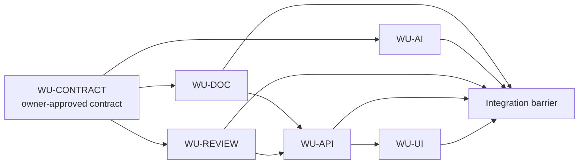

# Course 21 — Multi-Repository Parallel-Agent Delivery

> Enterprise Spec-Driven Development · Part IV: Agentic PDLC · Course 21 of 38

**Theme:** Coordinate multiple AI coding agents across independently owned repositories using dependency-aware scheduling, authenticated workload identity, leases, fencing tokens, idempotent operations, durable checkpoints, shared-contract invalidation, and exact-revision integration evidence.

**Level:** Advanced intermediate / staff AI scientist  
**Prerequisites:** [Course 10](../../beginner/10-specification-to-implementation-plan/README.md), [Course 11](../01-multi-agent-coding-workflows-coordination/README.md), [Course 17](../07-idea-discovery-spec-design-implementation/README.md), and [Course 20](../10-multi-repository-spec-driven-development-with-ai-coding-agents/README.md)  
**Case study:** Northstar Mutual — AI-2500 Broker Document Review  
**Practical stack:** Python standard library, real temporary Git repositories, OpenSpec-style deltas, JSON Schema, GitHub Actions, and `unittest`

## Course thesis

You should be able to explain, implement, evaluate, and productionize a parallel-agent delivery control plane that increases verified throughput without allowing agents to self-assign authority, reuse stale context, duplicate consequential effects, or substitute local completion for exact-revision system evidence.

## Learning outcomes

By the end, you will be able to:

1. decide whether parallelism is economically and operationally justified;
2. partition a system change into independently executable repository work units;
3. build and execute a dependency-aware work graph;
4. separate coordinator recommendations from trusted scheduler authority;
5. authenticate workload identity and attenuate repository, path, and tool scope;
6. enforce leases and monotonic fencing generations at the protected resource;
7. reconcile unknown outcomes through durable idempotency identities;
8. validate checkpoints before resume and recover after coordinator restart;
9. manage shared-contract changes with accountable approval and selective invalidation;
10. verify an exact multi-repository revision set at an integration barrier; and
11. compare sequential, naive-parallel, and governed-parallel delivery using honest metrics.

## Success criteria

You complete the course when you can run the lab, explain every trusted boundary, deliberately trigger each blocked path, interpret the scheduling comparison, complete the six workshop decisions, and defend why the final package is eligible for integration review but is not authorized to merge or deploy.

## Non-goals

This course does not claim to implement distributed consensus, a production identity provider, a GitHub App, a hosted agent platform, or release automation. It does not benchmark any model or vendor. The default lab is credential-free and all timing values come from a labelled deterministic event simulation.

## Risk boundary

Agents may propose code, checkpoints, work selection, contract changes, and integration candidates. Trusted application code authenticates principals, authorizes scope, issues and fences leases, validates exact revisions, executes checks, persists evidence, and determines readiness. Role names, prompt text, agent claims, branch names, and schema-valid JSON do not grant authority.

## Start here

From the repository root:

```bash
python3 curriculum/intermediate/11-multi-repository-parallel-agent-delivery/northstar-parallel-agents/lab.py
python3 -m unittest tests/test_course_21.py -v
```

Then use the guided [notebook](northstar-parallel-agents/parallel_agent_delivery.ipynb) and complete the [AI-2500 workshop](northstar-parallel-agents/README.md).

---

# Part I — Why parallel agents are difficult

## 1. Parallelism is not the objective

Five repositories and five available agents do not imply that five work units should start immediately. A naive fan-out can produce:

- AI Service implementing one contract while Review Service consumes another;
- two agents believing they own the same work after a timeout;
- duplicate pull requests after a lost response;
- a UI inventing fields before the API contract is approved;
- a late contract decision invalidating completed work; or
- five green repository suites and one incompatible system.

The objective is **verified delivery throughput**: approved change intent becomes an exact, reviewable system revision set with bounded rework and recoverable execution.

## 2. The economics of parallelism

A useful planning model is:

\[
T_{parallel} \approx T_{critical\ path} + T_{coordination} + T_{rework}
\]

Parallelism helps only when saved sequential time exceeds coordination and rework. Reviewer capacity, shared-contract churn, environment contention, and evidence latency can move the bottleneck even when implementation is parallel.

The lab models one comparable workload three ways:

| Strategy | Simulated elapsed time | Coordination | Rework | Interpretation |
| --- | ---: | ---: | ---: | --- |
| Sequential | 30 h | 0 h | 0 h | Safe baseline, longest critical path |
| Naive parallel | 23 h | 0 h | 15 h | Fast start, contract-driven rework |
| Governed parallel | 20 h | 3 h | 0 h | Coordination cost buys dependency safety |

These are deterministic teaching inputs, not measured model performance. Change the durations and graph in the lab before drawing a planning conclusion for another system.

## 3. When not to use parallel agents

Prefer one bounded worker when:

- one work unit dominates the critical path;
- the shared interface is unstable;
- work units edit the same protected artifact;
- integration or review capacity is the bottleneck;
- a small local change has low consequence and a cheap oracle;
- recovery cannot preserve independent completed work; or
- coordination cost is likely to exceed elapsed-time savings.

Parallel agents are an architectural choice, not an entitlement attached to repository count.

---

# Part II — Partition work before scheduling it

## 4. Preserve one canonical parent change

Northstar change `AI-2500` retains four authoritative system obligations:

| Requirement | Obligation |
| --- | --- |
| `REQ-2500-01` | Generate classification proposals for supported documents. |
| `REQ-2500-02` | Route ambiguous classifications to authorized human review. |
| `REQ-2500-03` | Prevent AI proposals from independently satisfying underwriting requirements. |
| `REQ-2500-04` | Preserve document, evidence, and model provenance. |

Parallel execution changes scheduling, not requirement ownership. The parent change remains authoritative regardless of how many workers are active.

## 5. Build the work-unit graph



After the contract is verified, Document, AI, and Review work can form one parallel wave. API waits for Document and Review. UI waits for API. Integration waits for all five exact repository revisions and their evidence.

## 6. Independence is semantic, not just physical

Before dispatching two work units concurrently, ask:

| Criterion | Required evidence |
| --- | --- |
| Contract stability | Both bind the same approved revision and digest. |
| Write isolation | Actual writable repositories and paths do not overlap. |
| Decision authority | Neither can redefine a protected shared decision. |
| Dependency readiness | Every prerequisite is verified, not merely reported complete. |
| Integration oracle | Their outputs can be evaluated together. |
| Recovery isolation | One failure does not silently invalidate the other. |

Different repositories can still conflict semantically. An AI agent that chooses the first plausible requirement conflicts with a Review agent that expects every ambiguous mapping to enter review even if Git sees no overlapping file.

## 7. Unknown dependencies are obligations

A graph is a maintained model, not omniscience. A missing edge is not proof of independence. Unknown consumers, dynamically discovered calls, batch jobs, and deployment coupling should create review or discovery obligations. Safe defaults depend on consequence; high-risk uncertainty should block or narrow parallelism.

---

# Part III — Coordinator, scheduler, and worker boundaries

## 8. Divide responsibilities

```text
planning assistant / coordinator
  proposes decomposition, next work, and escalation
                 │ untrusted recommendation
                 ▼
trusted control plane
  authenticates identity, evaluates dependencies, issues leases,
  enforces scope, records state, and resolves evidence
                 │ bounded grant
                 ▼
coding worker
  edits authorized paths, runs tools, submits a candidate/checkpoint
                 │ candidate artifact
                 ▼
trusted verification and integration
  executes checks against exact commits and protected contracts
```

The coordinator owns workflow assistance. It does not inherit business approval, contract ownership, repository administration, or release authority.

## 9. Work-unit state machine

```text
PLANNED → BLOCKED / READY → LEASED → RUNNING → SUBMITTED
                                                ↓
                                           VERIFYING
                                                ↓
                                            VERIFIED
                                                ↓
                                           INTEGRATED
```

Recovery paths include `PAUSED`, `FAILED`, `LEASE_EXPIRED`, `REWORK_REQUIRED`, `INVALIDATED`, and `ESCALATED`. Only the trusted control plane transitions state. An agent's “done” text cannot set `VERIFIED`.

## 10. Workload identity and capability attenuation

Authenticated runtime state supplies worker identity. The control plane then checks:

- repository membership;
- allowed path prefixes;
- allowed tools and operations;
- base commit and contract revision;
- lease generation and expiry; and
- retry, deadline, and cost budgets.

Production systems can use platform identities, OIDC, GitHub App installation tokens, or SPIFFE-compatible identities. The technology matters less than the invariant: identity is issued and verified outside model-controlled input, and delegated authority is no broader than its parent grant.

---

# Part IV — Leases, fencing, and protected writes

## 11. Why a state label is insufficient

Agent A owns `WU-AI`, loses connectivity, and stops heartbeating. After expiry, Agent B receives the work. Agent A later reconnects. Both processes may still execute. A timeout changes scheduler knowledge; it does not terminate the old process.

## 12. Locks, leases, and fencing tokens

| Mechanism | Strength | Limitation |
| --- | --- | --- |
| Process mutex | Prevents local concurrency | Does not coordinate machines |
| Distributed lock | Coordinates an ownership record | Old holder may keep executing after failure |
| Lease | Makes ownership time-bounded | Expiry does not stop the stale worker |
| Fencing token | Orders ownership generations | Protected resource must reject older tokens |

Course 21 combines a lease with a monotonically increasing generation:

```text
Agent A receives generation 41
lease expires
Agent B receives generation 42

submission service receives 41 → reject
submission service receives 42 → evaluate identity, scope, context, and artifact
```

Generating a token is not enforcement. The repository mutation, artifact, or submission service must compare the token with the current trusted generation.

The same rule applies at every effect boundary. In the reference implementation, an idempotency key is accepted only with the current lease, authenticated holder, repository, work unit, generation, and allowlisted capability. Authentication alone is insufficient, and a replacement worker cannot recover another worker's prior result by guessing its operation ID.

## 12.1 Trusted Git resolution

A worker submits only an immutable candidate commit. The trusted Git service resolves that commit in the authorized repository, proves that the approved base is an ancestor, and derives the actual diff. The worker does not report its own changed paths. Rename checks cover both old and new paths; deletions remain scope checked; the teaching policy rejects symlinks and submodules rather than allowing them to widen the work unit indirectly.

## 13. Atomic acquisition

A production scheduler should atomically verify `READY`, increment the generation, write the lease, and transition to `LEASED`. This typically requires a transaction, compare-and-swap, or other storage-specific concurrency primitive. An in-memory mutex in the lab teaches the invariant but is not a production distributed lock.

## 14. Time semantics

Lease code needs a trusted clock policy, expiry comparison, renewal rule, skew allowance, and failure behavior. The lab uses explicit UTC instants and rejects at `now >= expires_at`. Production systems should test boundary instants and avoid treating a worker-supplied timestamp as authoritative.

---

# Part V — Retries, idempotency, and unknown outcomes

## 15. At-least-once attempts are normal

Tool timeouts, process restarts, rate limits, and lost acknowledgements make retries unavoidable. If GitHub creates a PR but the response is lost, a second blind create can duplicate the effect.

Distinguish:

- **logical operation ID:** stable across uncertain retries;
- **attempt ID:** unique for each execution attempt; and
- **result identity:** durable external object such as PR `#182`.

## 16. Effectively-once outcomes

The lab creates a durable-shaped operation record under:

```text
AI-2500:WU-AI:CREATE_OR_UPDATE_PR:2
```

The record transitions through `PENDING`, `COMPLETED`, or `UNKNOWN_OUTCOME`. The same authorized logical request returns a completed result. Reusing the key for a different request or execution subject is rejected. If an effect may have happened before acknowledgement, retry is blocked until the adapter reconciles the external system using the stable logical identity. A production implementation needs durable atomic storage plus an outbox, provider idempotency primitive, or remote reconciliation; the in-memory fixture does not claim distributed exactly-once execution.

## 17. Retry policy

Classify errors:

- authentication, authorization, policy denial, invalid schema, stale context: terminal until inputs or authority change;
- transient dependency failure: bounded retry with backoff and the same logical operation identity;
- unknown external outcome: reconcile before retry;
- persistent failure after budget: `ESCALATED`, not an infinite agent loop.

The lab permits two retries and escalates the third failure.

---

# Part VI — Durable checkpoints and recovery

## 18. Conversation history is not a checkpoint

A transcript can contain unverified observations, secrets, obsolete reasoning, and irrelevant context. A durable checkpoint records actionable artifacts:

```json
{
  "work_unit_id": "WU-AI",
  "generation": 42,
  "base_commit": "<full-sha>",
  "contract_revision": 2,
  "completed": ["classification-adapter"],
  "remaining": ["ambiguity-negative-tests"],
  "evidence_ids": [],
  "discoveries": ["DISC-2500-019"],
  "unresolved": ["Q-CONTRACT-007"]
}
```

Discoveries remain claims until verified. Credentials and hidden reasoning are never checkpoint payloads.

## 19. Resume validation

Before a new worker resumes, verify:

1. the checkpoint belongs to the same work unit;
2. a newer current lease exists for the authenticated worker;
3. base commit still matches;
4. contract revision and digest remain current;
5. dependencies remain verified;
6. permissions remain valid; and
7. preserved evidence still covers the exact candidate.

Failure produces replan or revalidation, not blind continuation.

## 20. Coordinator restart

Durable state includes work-unit versions, lease generations, idempotency records, checkpoints, and event history. The lab snapshots an `UNKNOWN_OUTCOME`, restores it, reconciles the remote object by stable identity, and proves that it does not create a duplicate effect.

Production storage must additionally handle optimistic concurrency, queue redelivery, partial transactions, retention, disaster recovery, and tamper evidence.

---

# Part VII — Contract changes during execution

## 21. Agents discover gaps; owners approve revisions

Course 20 already established provenance in contract revision 2. In this course, an AI worker discovers that cross-run coordination also needs `producer_run_id`. It proposes revision 3. It cannot approve revision 3 itself.

```text
gap discovered
      ↓
CONTRACT_CHANGE_PROPOSAL
      ↓
impact analysis and accountable owner review
      ↓
approved revision + digest
      ↓
transitive affected-work invalidation
      ↓
targeted replan and fresh evidence
```

## 22. Selective invalidation

Revision 3 directly affects AI and Review. Their downstream API and UI work is transitively affected. Document work does not depend on the changed fields and stays ready. This preservation is safe only because the dependency model and impact evidence support it.

| Work unit | Disposition after revision 3 |
| --- | --- |
| Document | Preserve; no affected contract dependency |
| AI | Invalidate and replan as producer |
| Review | Invalidate and replan as consumer |
| API | Invalidate due to downstream dependency |
| UI | Invalidate due to transitive dependency |

If dependency completeness is uncertain, create review obligations rather than silently preserving work.

## 23. Evidence invalidation

Evidence is bound to the contract digest and candidate commit. Changing either changes the evidence subject. Old green receipts may still describe historical execution, but they cannot prove the new candidate.

Approval also revokes execution authority, not only logical status. For every affected unit the control plane removes the active lease, advances the fencing generation, revokes operation authority, invalidates checkpoints and evidence, and requires a fresh plan and lease. Retry uses the same transactional revoke-and-requeue rule so a failed holder never remains logically current.

---

# Part VIII — Integration barriers and revision sets

## 24. Local completion is not system readiness

Every repository can pass local tests while the combined system violates tenant isolation, authority, event ordering, or mixed-version compatibility. The integration barrier checks actual artifacts rather than agent status labels.

## 25. Exact-revision manifest

The lab produces:

```json
{
  "change_id": "AI-2500",
  "contract_revision": 2,
  "contract_digest": "sha256:<digest>",
  "component_commits": {
    "document-service": "<full-sha>",
    "ai-service": "<full-sha>",
    "review-service": "<full-sha>",
    "underwriting-api": "<full-sha>",
    "underwriter-ui": "<full-sha>"
  },
  "evidence_ids": ["EVID-WU-DOC-<sha>", "EVID-WU-AI-<sha>", "EVID-WU-REVIEW-<sha>", "EVID-WU-API-<sha>", "EVID-WU-UI-<sha>"],
  "system_evidence_id": "SYSTEM-<digest>"
}
```

A multi-repository system has no single Git commit. The manifest is the system revision set. Testing `(A, B)` does not prove `(A, C)` even when the public schema is unchanged.

## 26. Integration checks

Workers never submit evidence objects. A trusted evidence service resolves the candidate in the Git registry, observes repository test execution, computes the result digest, and registers the receipt. The trusted system harness then executes producer, Review Service, and Underwriting API calls against the exact component revision manifest.

Its negative scenarios attempt a high-confidence ambiguous classification, a cross-tenant proposal, a duplicate review operation, an expired approval, and an unauthorized authoritative mutation. The checks therefore fail on unsafe runtime behavior even if a Markdown contract or fixture flag still says the right thing.

The trusted barrier requires:

- all component work units in `VERIFIED`;
- five immutable full commit IDs matching submitted candidates;
- the exact approved contract revision and digest;
- trusted evidence for each component commit;
- a system-evidence receipt whose subject is the exact component revision set and whose executed scenarios cover ambiguity, tenant isolation, idempotency, expiry, provenance, and authority; and
- no attempted coordinator release authorization.

Passing produces `READY_FOR_INTEGRATION_REVIEW`. It never sets merge, deployment, activation, or retirement approval.

## 27. Coordinated merging

A production integration service should pin PR heads, re-check branch protection and approvals, enforce merge ordering where required, and rerun affected evidence after any head changes. “All PRs are green” is not a stable system subject unless the exact tested heads are the exact proposed heads.

---

# Part IX — Failure recovery

## 28. Preserve valid work

If Document and AI verify while Review fails, do not restart everything automatically. Reassign Review with a newer lease, preserve still-current exact evidence, keep API and UI blocked, and rerun system evidence for the final revision set.

| Failure | Governed response |
| --- | --- |
| Worker process crash | Expire, inspect checkpoint, issue newer generation |
| Old worker submits | Reject stale fencing token |
| Tool timeout | Bounded retry with same logical operation identity |
| Unknown PR outcome | Reconcile durable operation before retry |
| Contract revision | Invalidate affected work and evidence |
| Unauthorized path | Block submission and investigate |
| Integration mismatch | Diagnose cross-repository cause; create bounded rework |
| Retry budget exhausted | Escalate to accountable human/control |

## 29. Cancellation and stop conditions

Cancellation stops before the next tool or model action. It should not perform work and discard the result. Every work unit has terminal or escalated outcomes, retry limits, and an authority boundary. A text token such as `MISSION COMPLETE` has no lifecycle effect.

---

# Part X — Evaluation and observability

## 30. Measure verified flow

Useful measures include:

| Metric | Population and interpretation |
| --- | --- |
| Verified work units | Units with trusted evidence, not agent “done” messages |
| Change lead time | Approved intent to exact-revision integration eligibility |
| Coordination overhead | Scheduler, handoff, contract, and evidence time |
| Integration rework | Work repeated because parallel assumptions failed |
| Stale-context invalidation | Work invalidated by repository or contract movement |
| Human-review queue time | Waiting caused by approval capacity |
| Cost per verified change | Model, compute, CI, human review, retry, and rework cost |
| Forbidden outcomes | Actual unauthorized effects, separate from blocked attempts |

Segment by risk and complexity. Never sum parallel durations and report the total as elapsed latency.

## 31. Lab evaluation population

The fixture executes:

- 12 golden conformance scenarios;
- 30 labelled decisions: 7 positive, 15 negative, 5 boundary, and 3 failure/recovery;
- 6 system integration checks; and
- 34 focused unit tests.

`30/30` means the deterministic controls match this declared fixture population. It does not mean 100% model accuracy or production safety.

## 32. Observable traces

Record request, change, run, work-unit, worker, lease, generation, repository, base/candidate commit, contract revision, evidence, retry, error, and terminal state. Redact secrets and unnecessary content. Store reason codes and decisions, not private chain-of-thought.

---

# Part XI — Technology landscape

## 33. Select mechanisms by invariant

| Need | Common options | Selection considerations |
| --- | --- | --- |
| Workflow state | Relational DB, durable workflow engine, queue + state store | transactions, replay, visibility, recovery |
| Workload identity | CI OIDC, GitHub App, cloud workload identity, SPIFFE/SPIRE | attestation, rotation, audience, scope |
| Repository enforcement | protected branches, rulesets, GitHub App checks | exact head binding, bypass control, auditability |
| Coordination | DB row/version, lease API, lock service | failure model, fencing support, clock assumptions |
| Provenance | signed attestations, SLSA-compatible provenance | subject digest, builder identity, verification |
| Contracts | JSON Schema, OpenAPI, event schema registry, OpenSpec deltas | structural versus behavioral coverage |
| Observability | structured events, OpenTelemetry traces/metrics | correlation, retention, sensitive data |

GitHub Actions concurrency can serialize or cancel workflow groups, but that feature alone is not a cross-repository lease or a fencing mechanism. A durable workflow engine can simplify recovery, but it does not automatically solve authorization or contract ownership.

## 34. Established, emerging, and frontier practice

**Established:** dependency DAGs, least-privilege workload identity, protected branches, idempotent operations, immutable revisions, contract tests, and CI evidence.

**Emerging:** organization-wide agent control planes, signed context and evidence bundles, policy-compiled capability grants, and cross-repository revision-set registries.

**Research/frontier:** reliable semantic dependency discovery, formal composition of agent-generated changes, dynamic risk-aware scheduling, and calibrated prediction of coordination/rework cost. Treat these as open problems, not default production guarantees.

---

# Part XII — Worked lab and exercises

## 35. What the lab actually executes

The [lab package](northstar-parallel-agents/README.md):

1. creates five temporary Git repositories;
2. commits approved baseline and candidate states independently;
3. runs repository tests and derives actual changed paths and full commits;
4. schedules work through dependency, identity, lease, fencing, and scope controls;
5. verifies evidence through a separate integration identity;
6. injects stale workers, path widening, unknown outcomes, checkpoint drift, contract change, retry exhaustion, and revision mismatch;
7. restores durable state after coordinator restart; and
8. assembles one review-eligible, non-authoritative integration package.

## 36. Exercises

### Implementation

1. Add lease renewal with maximum extension and an auditable reason.
2. Add an attempt ID while preserving one logical operation ID across retries.
3. Add an `UNKNOWN_DEPENDENCY` state that requires explicit review disposition.

### Diagnosis

4. Change Review Service after evidence creation and explain every invalidated receipt.
5. Remove resource-level fencing while retaining scheduler leases. Demonstrate the stale-write failure.
6. Make the idempotency key omit contract revision and show an unsafe collision.

### Architecture judgment

7. Replace the in-memory store with a relational design. Specify transaction and uniqueness boundaries.
8. Decide whether UI and API should be one work unit or two for a given ownership model.
9. Design a reviewer-capacity constraint and show when adding coding agents increases queue time.
10. Write the accountable response when an AI worker proposes revision 3 after Review has committed revision 2.

## 37. Final design exercise

Three agents are active. AI Service discovers a shared-contract gap. Review Service already committed; Document Service is still running. Design the control-plane response. Identify which units pause, which exact evidence becomes stale, who approves the contract, how new generations and permissions are issued, what work is preserved, and which conditions reopen the integration barrier.

The key distinction is **parallel coding activity versus governed parallel delivery**.

## Summary

- Stabilize shared authority and contracts before fan-out.
- Schedule from trusted dependencies, not agent availability.
- Authenticate workers and attenuate capabilities.
- Pair leases with fencing enforced by the protected resource.
- Treat retries as at-least-once attempts and reconcile outcomes durably.
- Resume from validated artifacts, not conversation memory.
- Invalidate evidence whenever its exact subject changes.
- Measure verified flow, rework, and reviewer capacity—not agent busyness.
- Stop at integration-review eligibility unless separate accountable controls authorize more.

## References

- Gray and Cheriton, [Leases: An Efficient Fault-Tolerant Mechanism for Distributed File Cache Consistency](https://doi.org/10.1145/74850.74870), SOSP 1989.
- GitHub, [Workflow concurrency](https://docs.github.com/en/actions/concepts/workflows-and-actions/concurrency).
- GitHub, [About protected branches](https://docs.github.com/en/repositories/configuring-branches-and-merges/managing-protected-branches/about-protected-branches).
- SPIFFE, [SPIFFE Workload API specification](https://spiffe.io/docs/latest/spiffe-specs/spiffe_workload_api/).
- SLSA, [Provenance specification](https://slsa.dev/spec/v1.0/provenance).
- IETF, [RFC 9110: HTTP Semantics](https://www.rfc-editor.org/rfc/rfc9110).
- JSON Schema, [Draft 2020-12](https://json-schema.org/draft/2020-12).
- OpenSpec, [official documentation](https://github.com/Fission-AI/OpenSpec/blob/main/docs/README.md).
- OpenTelemetry, [Trace specification](https://opentelemetry.io/docs/specs/otel/trace/).

Next: **Course 22 — Pull Request and Review Strategy**, which compares spec-first PR sequences, implementation PRs, integration PRs, and mega-PRs through review quality, lead time, rework, conflicts, and evidence.
